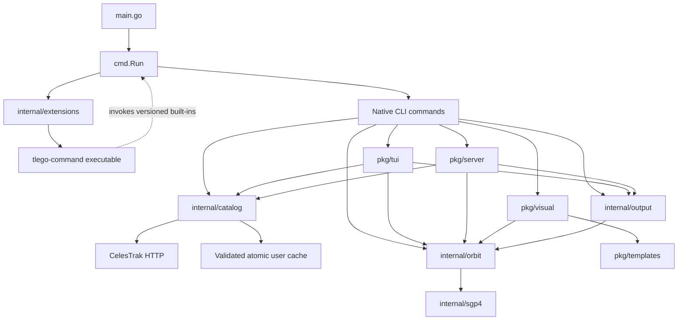

# TLEGO architecture

## Purpose

TLEGO retrieves satellite elements, computes positions and pass estimates, and exposes catalog, tracking, report and orbit visualization workflows through CLI, terminal UI and HTTP frontends. Independent executables extend the CLI.

## Scope and Assumptions

Verified on 2026-10-28 against the current repository, using the previous ARCHITECTURE.md baseline and inspecting the implemented packages. The core and executable extension system is implemented. GP JSON ingestion and direct SGP4 initialization are implemented. Runtime TUI/provider extensions remain outside the executable extension contract.

## System Overview

The Go host separates shared catalog access, orbital calculations, output encoding and executable extension dispatch under internal/. Frontends orchestrate these concrete packages. Public pkg APIs remain available through compatibility wrappers where ownership moved.

The CLI uses urfave/cli v3 and the TUI uses Bubble Tea. internal/sgp4 carries the pinned go-satellite-v2 numerical engine with a direct mean-element initializer. The upstream dependency remains for legacy public APIs and coordinate conversions. Extensions run as separate processes and can consume versioned built-in JSON output.

## Architecture Diagram

## Runtime Entry Points

- main.go calls cmd.Run, prints unreported errors to stderr and preserves extension exit codes.
- cmd/root.go owns the CLI; individual cmd files register native commands through init. cmd/run.go chooses native commands before external dispatch.
- cmd/plugin.go exposes plugin list and plugin init. Initialization writes a new standalone Go or Python project from embedded templates without invoking external tools or overwriting existing directories.
- cmd/tui.go calls pkg/tui.RunContext.
- cmd/server.go calls pkg/server.Serve with context cancellation. The CLI defaults to 127.0.0.1:8080; --addr and --static-dir configure serving.
- pkg/server.NewHandler exposes the legacy API plus the versioned position endpoint without registering on the global mux.
- examples/ contains standalone Go examples and the independently packaged Python calendar extension.

## Architectural Layers

| Area | Responsibility | Dependencies and limits |
|---|---|---|
| cmd | Input validation, orchestration, presentation and dispatch | Shared core and frontend entry points; no independent fetching or propagation |
| internal/catalog | Embedded groups, ID validation, HTTP retrieval, cache policy, provenance and deduplicated search | Standard HTTP/filesystem and internal/elements parsing; no UI or orbital calculation |
| internal/elements | Shared TLE line/payload validation and parsing, GP JSON records, exact catalog IDs and original source | Standard library and legacy TLE field types; no fetching or propagation |
| internal/sgp4 | Direct mean-element initialization and near-Earth/deep-space propagation | Source-carried numerical engine with upstream license and provenance |
| internal/orbit | UTC propagation, TEME vectors, geographic coordinates, vector speed, derived orbit estimates, observers and pass sampling | Internal SGP4 engine and dependency coordinate conversions; no HTTP, filesystem, output encoding or terminal state |
| internal/output | Legacy report encoding and explicit JSON v1 transport records | Orbit types and element records; no fetching or process execution |
| internal/extensions | PATH discovery, direct executable launch, streams, status, cancellation and embedded starter generation | Standard process/filesystem APIs; Windows cleanup uses the existing x/sys dependency |
| pkg/tui | Screen/input state, settings, selected records with provenance, cancellable requests, tracking sessions and pass results | Core packages; old exported domain/report helpers remain wrappers |
| pkg/server | HTTP request validation, response adapters and static serving | Shared catalog, orbit and output packages |
| pkg/visual, pkg/templates | Orbit sampling and embedded offline HTML export | Core orbital states, export validation and the pinned compiled viewer |
| pkg/celestrak, pkg/tui/data | Historical public catalog APIs | Thin adapters to internal/catalog; mutable legacy URL/download configuration remains supported |
| pkg/tle, pkg/utils | Historical parser/conversion APIs | Public TLE parsing adapts internal/elements with unchanged exported types; legacy conversion helpers remain |

## External Integrations

- CelesTrak supplies group and single-object elements over HTTPS. Active frontends request GP JSON. Local ingestion accepts GP JSON objects/arrays and legacy TLE.
- go-satellite-v2 supplies legacy TLE parsing and coordinate conversions. internal/sgp4 preserves its numerical implementation while accepting full mean elements, fractional epochs and catalog IDs up to nine digits. Active propagation returns SGP4 errors and rejects non-finite states. Legacy exported propagation helpers retain their original signatures.
- Google Maps and OpenStreetMap links consume degree coordinates.
- Default group YAML, orbit templates and the compiled viewer are embedded. The viewer bundles Three.js/OrbitControls and Natural Earth outlines; exports make no asset requests.
- Diagnostics from pkg/logger go to stderr.
- examples/calendar is a Python console-script package using only the standard library at runtime. The Go host does not depend on Python.

## Core Data Flow (Current)

All frontends retrieve through internal/catalog.Store. A request validates its ID before network/filesystem access, validates usable cache records, performs bounded context-aware HTTP retrieval when needed, validates the payload before atomic cache replacement, and can fall back to a valid stale cache with a warning. GP JSON uses isolated elements/norad and elements/groups cache directories. Valid legacy .tle caches remain usable offline, and expired legacy records can be a fallback when JSON retrieval fails. A valid JSON cache takes priority over legacy data. Cache modification time records retrieval freshness; element epoch remains separate. Group lookup ignores case. Shared search deduplicates matches and retains each selected record with its retrieval metadata. It returns coverage and warns on partial results. Deadline expiry preserves successful coverage; explicit cancellation and complete retrieval failure remain errors. Local input passes through the same element validation without a provider request.

Cache lifecycle and refresh coordination live in internal/catalog/cache.go. Valid fresh cache hits bypass active refreshes. Equivalent overlapping requests share one refresh outcome, including stale fallback or provider failure. Default stores share one private HTTP client. Explicit custom clients retain separate identities. Waiters have independent cancellation and receive copies of mutable record data. A canceled leader allows remaining callers to retry. Coordination uses absolute paths and remains process-local. TLE and GP use the same lifecycle with typed decoders and explicit legacy fallback.

internal/elements owns TLE line and payload validation before the retained upstream field parser runs. Catalog and public pkg/tle entry points share these rules. Public legacy structs and signatures remain available through conversion adapters.

internal/orbit.Propagator.At converts evaluation time to whole-second UTC, retains the full element epoch, propagates TEME position and velocity in km and km/s, converts latitude/longitude to degrees with longitude in [-180, 180), and derives altitude and vector speed. PlanPasses validates the observer and sample budget, then samples the zero-degree horizon with clipped-window flags. Pass events and maxima have the declared sampling resolution. Context-aware pass APIs stop sampling on cancellation; the original APIs remain wrappers. PositionFromSatellite, OrbitInfoFromTLE and TUI ComputePasses retain their original public signatures through adapters.

internal/output builds legacy reports with explicit generation time and encodes legacy text, JSON and CSV. Versioned JSON uses separate position/report/pass records and provenance. CLI predict/report/passes support --format json and --schema-version 1.0; stdout receives one complete successful document, while failures use JSON stderr and a nonzero status. The TUI retains legacy json and adds json-v1. Selected records carry their retrieval metadata through group and search caches. Requests inherit the program context and cancel on replacement, navigation or exit. Tracking ticks identify their session. A successful reload of the same tracked satellite resumes with one new-session tick. Pass results retain their element version, observer, window and step; observer or element changes invalidate them. Report replacement uses a checked temporary file and preserves existing permission bits. New reports keep private temporary-file permissions. Existing destination symlinks resolve to their targets before atomic replacement; unresolved links return an error. HTTP retains /api/location and adds /api/v1/position. GP reports preserve the original object in element_data and leave the legacy tle string empty. source_format identifies gp-json; no synthetic TLE is created. Field names and units are documented in docs/schema-v1.json and docs/extensions.md.

The viz command accepts a live catalog ID or a validated local TLE or GP JSON file. pkg/visual samples core states from one UTC start and atomically writes embedded data, renderer and CSS. Points are physical TEME kilometres with UTC times and metadata. The frontend maps axes into Three.js, rotates the globe using UTC-derived GMST, and interpolates only within the common sample interval. The viewer bundle has a separate Node build/check job; Go consumers do not need Node.

The experimental public browser client owns one active selection request. New selections abort previous requests and reject their late responses. HTTP failures show a status message and preserve the last complete scene. Group changes clear old satellite choices, and empty choices remain disabled after failure.

Unknown valid top-level commands resolve to tlego-command on PATH. Built-in names and aliases always win; invalid native flags do not trigger dispatch. Extensions inherit arguments, streams, environment and working directory. Discovery lists paths without executing code. plugin init creates standalone projects from internal/extensions/templates with a sample command, tests and installation instructions. docs/writing-extensions.md explains extension development. The Python calendar example consumes pass-plan JSON and emits an iCalendar file as an independent process.

## Module Ownership Boundaries

- Core packages do not import cmd, pkg/tui or pkg/server. UI request state and rendering remain in the frontend.
- internal/sgp4 owns numerical SGP4 calculations and direct initialization. TLEGO owns consistent time, units, input validation and output contracts. Changes to the source-carried numerical files require comparison with the pinned upstream revision and reference-vector validation.
- Settings and recent-history persistence remain TUI concerns. Selection metadata, pass input identity and tracking session identity belong to the TUI. Report generation time is explicit in the reusable builder.
- Versioned transport records are separate from legacy exported Go/report structures. Schema additions must remain compatible within a major version.
- Executable extensions add commands only. They do not inject TUI panels, replace providers or register in-process callbacks. They run with the user's permissions and are not sandboxed by the host.
- Public pkg APIs are compatibility commitments. Thin wrappers remain where implementations moved into internal/.

## Architecture Change Protocol

1. Describe behavior and compatibility changes in the pull request.
2. Keep this file aligned with implemented ownership. docs/extensions.md and docs/schema-v1.json define the executable and transport contracts.
3. Keep units, UTC, malformed input, cache preservation and stream/exit behavior covered by regression tests.
4. Preserve exported APIs and legacy JSON contracts when changing internal ownership; introduce explicit versions for breaking transport changes.
5. Run packaged-binary checks outside the checkout and verify an independent consumer when changing extension contracts.

## Future Clarifications

- Orbit classifications use declared period, shape and altitude heuristics. Both input paths share two-body estimates checked against independent high-precision ellipse calculations; these do not establish SGP4 trajectory extrema or station keeping. See docs/orbit-estimates.md for criteria and limits.
- Runtime TUI panels, custom providers, extension installation and a marketplace require separate designs based on actual use.
