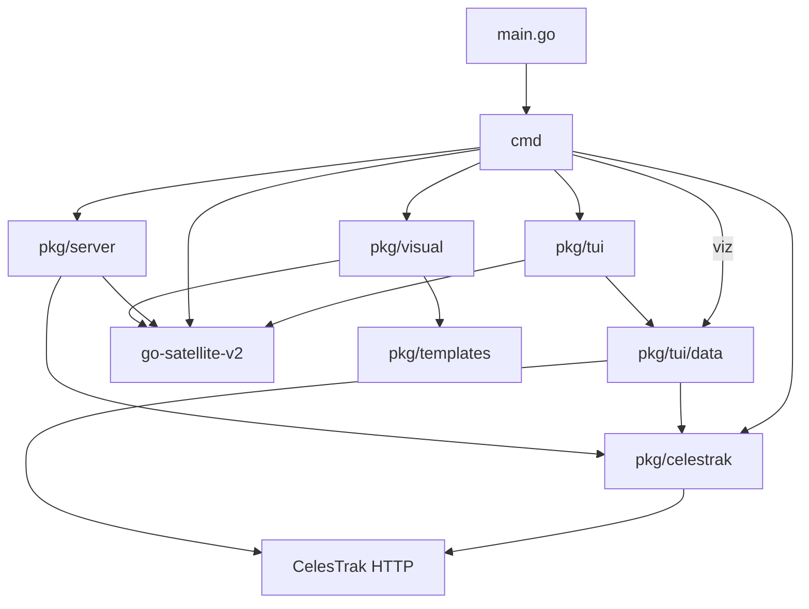

# TLEGO architecture

## Purpose

TLEGO retrieves satellite elements, computes positions, and exposes catalog, tracking, report and orbit visualization workflows through a CLI, terminal UI and HTTP server.

## Scope and Assumptions

Verified on 2026-10-25 from README.md, docs/tui-spec.md and the visualization update based on main commit 80462ad. This document describes the implemented baseline. The proposed core/extension refactor is tracked in GitHub issue #29 and is not part of the current architecture.

## System Overview

The CLI uses urfave/cli v3. Bubble Tea implements the TUI. Both use the pinned go-satellite-v2 dependency for orbital calculations. The viz command now shares the validated TUI data store; other legacy commands/server retain a separate retrieval path.

## Architecture Diagram

## Runtime Entry Points

- main.go calls cmd.RootCmd.Run, writes failures to stderr and exits nonzero.
- cmd/root.go owns the root CLI; individual cmd files register commands through init.
- cmd/tui.go calls pkg/tui.Run.
- cmd/server.go calls pkg/server.StartServer, which registers handlers on the default HTTP mux and serves public/ on port 8080.
- examples/ contains standalone Go example programs.

## Architectural Layers

| Current area | Responsibility | Known boundary problem |
|---|---|---|
| cmd | Arguments, commands and text output | Direct fetching and propagation duplicate TUI behavior |
| pkg/celestrak | Group configuration and HTTP-to-file TLE retrieval | Legacy direct-download behavior and a relative downloads directory |
| pkg/tui/data | HTTP client, user cache and stale fallback | Shared behavior belongs outside TUI; validated cache replacement and stale fallback are implemented |
| pkg/tui | UI state, settings, computation and report formatting | Reusable domain computations depend on UI package ownership |
| pkg/server | HTTP responses and static files | Direct propagation and fetches diverge from other frontends |
| pkg/visual, pkg/templates | Orbit sampling and embedded HTML export | Validated TEME-km samples and atomic HTML exports; a pinned offline viewer is embedded |
| pkg/tle, pkg/utils | Local parser and conversion helpers | Active fetches use the dependency parser instead |

## External Integrations

- CelesTrak supplies group and single-object elements over HTTPS. Current queries request TLE format.
- go-satellite-v2 supplies TLE parsing, SGP4 propagation and conversions. Locate returns radians and an approximate speed; Propagate returns position and velocity vectors.
- Google Maps and OpenStreetMap links consume geographic coordinates.
- Default group YAML, orbit templates and the compiled viewer are embedded. The viewer bundles Three.js/OrbitControls and Natural Earth outlines; exports make no asset requests.
- pkg/logger writes diagnostic logs to stdout.

## Core Data Flow (Current)

Legacy CLI/server retrieval calls pkg/celestrak, downloads into a file and parses it using the external tle package. GetSatelliteTLEByNoradID selects the first parsed result. Most CLI position paths call Locate directly; HTTP uses Propagate and a local conversion helper.

TUI retrieval calls pkg/tui/data.Store, validates IDs and TLE records, checks cache timestamps, validates temporary downloads before replacement and can fall back to validated stale files. pkg/tui/derive.go normalizes UTC, converts positions and uses the propagated velocity vector; pkg/tui/passes.go samples horizon events with clipping flags; pkg/tui/report.go formats report records. Observer and recent-history state persist atomically in the user configuration directory. Request generations reject superseded results, and text fields own their printable input.

The viz command accepts a live catalog ID or validated local TLE file. It samples all records from one UTC start through pkg/visual, then writes JSON data plus embedded renderer/CSS through an error-returning atomic writer. Points are physical TEME kilometres with UTC times and derived metadata. The frontend maps axes into Three.js, rotates the globe using sampled GMST, and interpolates only within the common sample interval. Its committed bundle is rebuilt and checked in a separate Node CI job; Go consumers do not need Node.

## Module Ownership Boundaries

- The current propagation library owns numerical SGP4 calculations. TLEGO must verify its return types and frame/time assumptions rather than infer them from variable names.
- Terminal screen state and rendering belong to pkg/tui. Domain calculation and catalog ownership are currently mixed with that UI.
- No executable plugin dispatcher or stable external schema is implemented.
- The exported pkg APIs are potential compatibility commitments. Unknown external users must not be assumed absent when removing them.

## Architecture Change Protocol

1. Record behavior and compatibility changes in the relevant review or pull request.
2. Keep current state in this document and proposals in [GitHub issue #29](https://github.com/Mohammed-Ashour/tlego/issues/29).
3. Correct units, UTC and failure contracts with regression tests before migrating callers.
4. Migrate one frontend at a time. Preserve exported APIs with deprecation wrappers where needed; do not silently change existing JSON contracts.
5. Update this document in each structural change and close linked issues only after their acceptance checks pass.

## Future Clarifications

- The propagation engine's modern mean-element initialization support must be verified before implementing GP JSON ingestion.
- Required external Go library compatibility and intended public APIs need documentation.
- Extension v1 is proposed as command execution only. Custom providers and TUI panels require a separate future decision.
