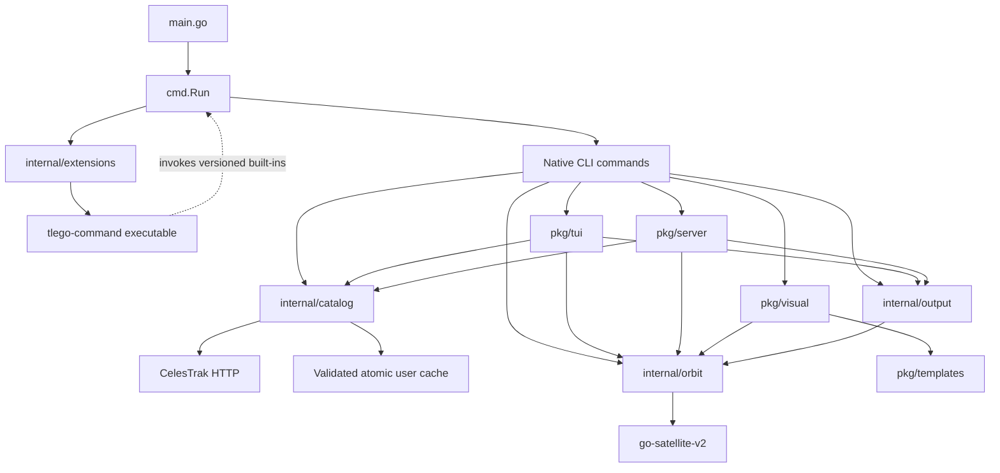

# TLEGO architecture

## Purpose

TLEGO retrieves satellite elements, computes positions and pass estimates, and exposes catalog, tracking, report and orbit visualization workflows through CLI, terminal UI and HTTP frontends. Independent executables extend the CLI.

## Scope and Assumptions

Verified on 2026-10-25 against the current repository, using the previous ARCHITECTURE.md baseline and inspecting the implemented packages. The core and executable extension system is implemented. GP JSON/OMM ingestion, independent numerical reference validation and runtime TUI/provider extensions are outside this refactor.

## System Overview

The Go host separates shared catalog access, orbital calculations, output encoding and executable extension dispatch under internal/. Frontends orchestrate these concrete packages. Public pkg APIs remain available through compatibility wrappers where ownership moved.

The CLI uses urfave/cli v3 and the TUI uses Bubble Tea. The pinned go-satellite-v2 dependency owns SGP4 numerical calculations. Extensions run as separate processes and can consume versioned built-in JSON output.

## Architecture Diagram

## Runtime Entry Points

- main.go calls cmd.Run, prints unreported errors to stderr and preserves extension exit codes.
- cmd/root.go owns the CLI; individual cmd files register native commands through init. cmd/run.go chooses native commands before external dispatch.
- cmd/plugin.go exposes plugin list and plugin init. Initialization writes a new standalone Go or Python project from embedded templates without invoking external tools or overwriting existing directories.
- cmd/tui.go calls pkg/tui.RunContext.
- cmd/server.go calls pkg/server.Serve with context cancellation. The CLI defaults to 127.0.0.1:8080; --addr and --static-dir configure serving.
- pkg/server.NewHandler exposes the legacy API plus the versioned position endpoint without registering on the global mux.
- examples/ contains standalone Go examples and the independently packaged Python calendar extension.

## Architectural Layers

| Area | Responsibility | Dependencies and limits |
|---|---|---|
| cmd | Input validation, orchestration, presentation and dispatch | Shared core and frontend entry points; no independent fetching or propagation |
| internal/catalog | Embedded groups, ID and element validation, HTTP retrieval, cache policy, provenance and deduplicated search | Standard HTTP/filesystem and the dependency TLE parser; no UI or orbital calculation |
| internal/orbit | UTC propagation, TEME vectors, geographic coordinates, vector speed, derived orbit estimates, observers and pass sampling | Pinned satellite library; no HTTP, filesystem, output encoding or terminal state |
| internal/output | Legacy report encoding and explicit JSON v1 transport records | Orbit types and TLE records; no fetching or process execution |
| internal/extensions | PATH discovery, direct executable launch, streams, status, cancellation and embedded starter generation | Standard process/filesystem APIs; Windows cleanup uses the existing x/sys dependency |
| pkg/tui | Screen/input state, settings, request generations and rendering | Core packages; old exported domain/report helpers remain wrappers |
| pkg/server | HTTP request validation, response adapters and static serving | Shared catalog, orbit and output packages |
| pkg/visual, pkg/templates | Orbit sampling and embedded offline HTML export | Core orbital states, export validation and the pinned compiled viewer |
| pkg/celestrak, pkg/tui/data | Historical public catalog APIs | Thin adapters to internal/catalog; mutable legacy URL/download configuration remains supported |
| pkg/tle, pkg/utils | Historical parser/conversion APIs | Retained for compatibility; active frontends use the shared core |

## External Integrations

- CelesTrak supplies group and single-object elements over HTTPS. Current ingestion supports TLE, not GP JSON/OMM.
- go-satellite-v2 supplies TLE parsing, SGP4 propagation and coordinate conversions. Its Propagate function returns vectors without an error result. The core rejects non-finite states but does not claim complete detection of numerical propagation failures.
- Google Maps and OpenStreetMap links consume degree coordinates.
- Default group YAML, orbit templates and the compiled viewer are embedded. The viewer bundles Three.js/OrbitControls and Natural Earth outlines; exports make no asset requests.
- Diagnostics from pkg/logger go to stderr.
- examples/calendar is a Python console-script package using only the standard library at runtime. The Go host does not depend on Python.

## Core Data Flow (Current)

All frontends retrieve through internal/catalog.Store. A request validates its ID before network/filesystem access, validates usable cache records, performs bounded context-aware HTTP retrieval when needed, validates a temporary payload before atomic cache replacement, and can fall back to a valid stale cache with a warning. Cache modification time records retrieval freshness; element epoch remains separate. Group lookup ignores case. Shared search deduplicates matches, returns coverage and warns on partial results; complete retrieval failure is an error. Local input passes through the same element validation without a provider request.

internal/orbit.At converts evaluation time to whole-second UTC, propagates TEME position and velocity in km and km/s, converts latitude/longitude to degrees with longitude in [-180, 180), and derives altitude and vector speed. PlanPasses validates the observer and sample budget, then samples the zero-degree horizon with clipped-window flags. Pass events and maxima have the declared sampling resolution. PositionFromSatellite, OrbitInfoFromTLE and TUI ComputePasses retain their original public signatures through adapters.

internal/output builds legacy reports with explicit generation time and encodes legacy text, JSON and CSV. Versioned JSON uses separate position/report/pass records and provenance. CLI predict/report/passes support --format json and --schema-version 1.0; stdout receives one complete successful document, while failures use JSON stderr and a nonzero status. The TUI retains legacy json and adds json-v1. HTTP retains /api/location and adds /api/v1/position. Field names and units are documented in docs/schema-v1.json and docs/extensions.md.

The viz command accepts a live catalog ID or a validated local TLE file. pkg/visual samples core states from one UTC start and atomically writes embedded data, renderer and CSS. Points are physical TEME kilometres with UTC times and metadata. The frontend maps axes into Three.js, rotates the globe using UTC-derived GMST, and interpolates only within the common sample interval. The viewer bundle has a separate Node build/check job; Go consumers do not need Node.

Unknown valid top-level commands resolve to tlego-command on PATH. Built-in names and aliases always win; invalid native flags do not trigger dispatch. Extensions inherit arguments, streams, environment and working directory. Discovery lists paths without executing code. plugin init creates standalone projects from internal/extensions/templates with a sample command, tests and installation instructions. docs/writing-extensions.md explains extension development. The Python calendar example consumes pass-plan JSON and emits an iCalendar file as an independent process.

## Module Ownership Boundaries

- Core packages do not import cmd, pkg/tui or pkg/server. UI request state and rendering remain in the frontend.
- The propagation library owns numerical SGP4 calculations. TLEGO owns consistent time, units, input validation and output contracts.
- Settings and recent-history persistence remain TUI concerns. Report generation time is explicit in the reusable builder.
- Versioned transport records are separate from legacy exported Go/report structures. Schema additions must remain compatible within a major version.
- Executable extensions add commands only. They do not inject TUI panels, replace providers or register in-process callbacks. They run with the user's permissions and are not sandboxed by the host.
- Public pkg APIs are compatibility commitments. Thin wrappers remain where implementations moved into internal/.

## Architecture Change Protocol

1. Describe behavior and compatibility changes in the pull request.
2. Keep this file aligned with implemented ownership. docs/extensions.md and docs/schema-v1.json define the executable and transport contracts.
3. Keep units, UTC, malformed input, cache preservation and stream/exit behavior covered by regression tests.
4. Preserve exported APIs and legacy JSON contracts when changing internal ownership; introduce explicit versions for breaking transport changes.
5. Run packaged-binary checks outside the checkout and verify an independent consumer when changing extension contracts.

## Future Clarifications

- GP JSON/OMM support must verify modern mean-element initialization without truncating catalog IDs into TLE fields.
- Orbit classifications and derived orbital estimates need independent numerical reference validation, tracked in issue #27.
- Runtime TUI panels, custom providers, extension installation and a marketplace require separate designs based on actual use.
