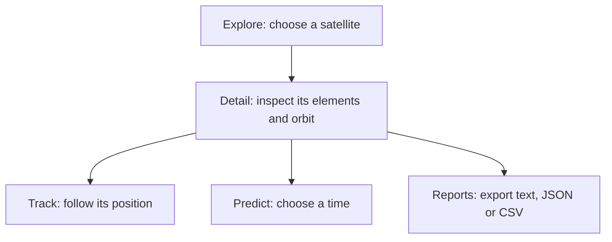
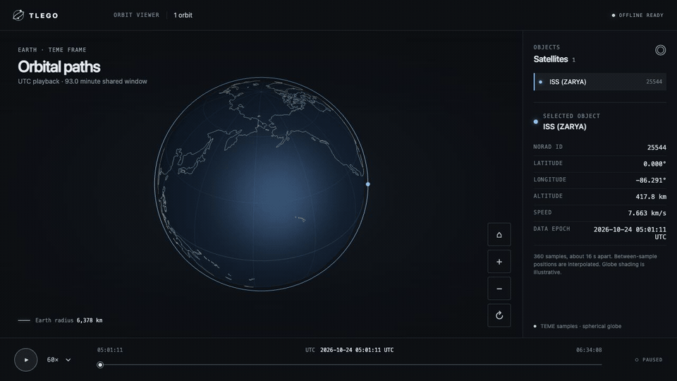

# TLEGO

Browse satellites, inspect their orbits, and track their positions from your terminal. TLEGO is a Go CLI with a keyboard-driven terminal UI, CelesTrak data access, and HTML orbit exports.

[](assets/tui-demo.mp4)

*An offline ISS walkthrough using a saved 2026-10-24 element set.* [Download the MP4](https://github.com/Mohammed-Ashour/tlego/raw/refs/heads/main/assets/tui-demo.mp4) · [Run or record the demo](docs/demos/README.md)

[Get started](#get-started) · [Try it offline](#try-it-offline) · [Use the TUI](#use-the-tui) · [CLI commands](#cli-commands) · [Development](#development)

## Get started

Install [Go](https://go.dev/doc/install) 1.23.1 or newer, then install the current main branch:

```bash
go install github.com/Mohammed-Ashour/tlego@main
tlego tui
```

The TUI is on `main`. Older tagged releases selected by `@latest` do not include it yet. If your shell cannot find `tlego`, add Go's binary installation directory to `PATH`. By default, this is the `bin` directory under `go env GOPATH`, unless you set `GOBIN`.

Open the ISS directly or choose a satellite group:

```bash
tlego tui --norad 25544
tlego tui --group "Space Stations"
```

These commands fetch live data when a usable cache is unavailable. To see the interface without provider access, use the offline example below.

## Try it offline

```bash
git clone https://github.com/Mohammed-Ashour/tlego.git
cd tlego
go run ./examples/tui-demo
```

This runs the same TUI shown in the animation. It uses an embedded ISS snapshot, a Greenwich observer, and temporary cache/settings directories. Network requests are blocked. Your regular configuration stays untouched.

The snapshot is archived; displayed positions use your machine's current clock. Use it to explore the interface, then run `tlego tui` for current data. The first `go run` may download Go dependencies even though the example itself makes no provider requests.

<a id="terminal-ui"></a>

## Use the TUI

Start in Explore, choose a satellite, then follow the workflow you need:



| Want to… | Start here |
|---|---|
| Find a satellite | Explore, then `/` to search by name or catalog ID |
| Inspect its orbit | Detail, with tabs for summary, TLE, orbit, ground track and passes |
| Follow its position | Track, then Space to start or stop updates |
| Look ahead | Predict, then enter `+2h`, `+0.5d` or an RFC3339 timestamp |
| Save a report | Reports, choose a format, generate, then save |
| Estimate local passes | Settings to set your observer, then Detail → Passes and p |

### Keyboard essentials

| Keys | Action |
|---|---|
| Left/Right or h/l | Switch screens outside text fields |
| Tab / Shift+Tab | Move between lists, fields and inputs |
| Enter | Search, open a selection, or submit a prediction |
| Escape | Leave a text field so navigation keys work again |
| q / Ctrl+C | q returns Home, then exits; Ctrl+C exits anywhere |
| ? / Page Up / Page Down | Show help / scroll long content |

On Reports, f changes format, r generates, Tab edits the save path, and s saves after you leave the field. In Settings, Ctrl+S saves. Observer altitude is in km.

`tlego tui --track 25544` opens Track; Space starts updates. `tlego tui --screen Settings` opens observer settings directly. The default observer is 0° latitude, 0° longitude, so configure a location before using passes.

### Cache and settings

The TUI stores validated elements in the platform user cache directory under `tlego`. If a refresh fails, it can use a valid stale cache and displays a warning. r reloads through the cache and respects its TTL; it does not force a provider download.

Settings and recent satellites live in the platform user configuration directory under `tlego/tui.yaml`. An absolute `XDG_CONFIG_HOME` overrides the settings directory. [TUI implementation notes](docs/tui-spec.md) cover paths, startup options and behavior in detail.

## CLI commands

The terminal UI is the recommended route for position calculations. The older `predict`, `track` and `report` commands still have tracked [coordinate-unit](https://github.com/Mohammed-Ashour/tlego/issues/16) and [UTC-handling](https://github.com/Mohammed-Ashour/tlego/issues/17) bugs.

| Command | What it does |
|---|---|
| `tlego tle 25544` | Fetch the ISS element set |
| `tlego list --sat-group "Space Stations"` | Fetch a configured group's elements; use the catalog's exact spelling |
| `tlego search starlink` | Search names across configured groups |
| `tlego viz 25544` | Write a self-contained orbit viewer to `25544.html` |
| `tlego server` | Start the experimental web UI/API on port 8080 from the checkout |
| `tlego --help` | List all commands; add `--help` to a command for its options |

The orbit viewer uses the TUI's validated cache store. Other legacy CLI retrieval commands still use a separate download path; their caching and failure behavior are being consolidated. The experimental server binds all interfaces and serves the checkout's `public/` directory; see [the input/binding issue](https://github.com/Mohammed-Ashour/tlego/issues/22) before exposing it to a network.

### Orbit viewer

[](assets/orbit-demo.mp4)

[Download the orbit walkthrough MP4](https://github.com/Mohammed-Ashour/tlego/raw/refs/heads/main/assets/orbit-demo.mp4). [Static preview](assets/orbit-demo.jpg). This recording uses the saved ISS snapshot at its 2026-10-24 epoch.

Fetch the ISS and export its orbit:

```bash
tlego viz 25544 --output iss-orbit.html
```

From a checkout, generate the same view as the video without a provider request:

```bash
go run . viz --file examples/tui-demo/iss.tle --output iss-orbit.html
```

Open the HTML in a WebGL 2-capable browser. The exported file includes its renderer, styles, geography and orbit samples, so it needs no external assets. Drag to orbit the camera, scroll to zoom, or use the camera buttons. Play/Pause, speed and the UTC slider control the sampled timeline.

Local files may contain multiple satellites. `--time` chooses a shared RFC3339 start; `--points` controls samples per orbit. Without `--time`, live lookups start now and local files start at their first element's epoch. Playback begins paused and stays inside the shared sample interval.

The globe and trajectories use the same physical scale. Lighting is illustrative, the globe is spherical, and between-sample positions are interpolated. [Visualization guide](docs/visualization.md) explains the limits and compatibility changes.

## Current limits and next steps

- Retrieval uses TLE data. Full coverage of newer catalog objects needs [GP/OMM support](https://github.com/Mohammed-Ashour/tlego/issues/18).
- Pass events and maxima are sampled at one-minute steps. Clipped forecast boundaries are marked. Optical visibility and precision antenna control are not calculated.
- Orbit classes use altitude-based heuristics; apogee and perigee are estimates. Independent scientific validation is [tracked separately](https://github.com/Mohammed-Ashour/tlego/issues/27).
- TUI JSON reports are unversioned exports. The [shared core and extension contract](https://github.com/Mohammed-Ashour/tlego/issues/29) are planned work; executable plugins are not implemented yet.

[Browse the backlog](https://github.com/Mohammed-Ashour/tlego/issues) for the current priorities and acceptance criteria.

## Development

From a checkout:

```bash
go build -o bin/tlego .
go test ./...
go vet ./...
```

CI builds and tests on Linux, macOS and Windows. Use `go test -race ./...` when changing concurrent behavior on a supported platform.

Read [ARCHITECTURE.md](ARCHITECTURE.md) for the current package boundaries, [the TUI notes](docs/tui-spec.md) for interaction behavior, and [the recording guide](docs/demos/README.md) to update the walkthrough. Keep pull requests focused and include the relevant checks. For new behavior, start from a tracked issue or describe the proposed change in the PR.

## Data, dependencies and license

Satellite elements come from [CelesTrak](https://celestrak.org/). Propagation uses [go-satellite-v2](https://github.com/Mohammed-Ashour/go-satellite-v2); the TUI uses [Bubble Tea](https://github.com/charmbracelet/bubbletea), and commands use [urfave/cli](https://github.com/urfave/cli).

TLEGO is available under the [MIT license](LICENSE.md).
