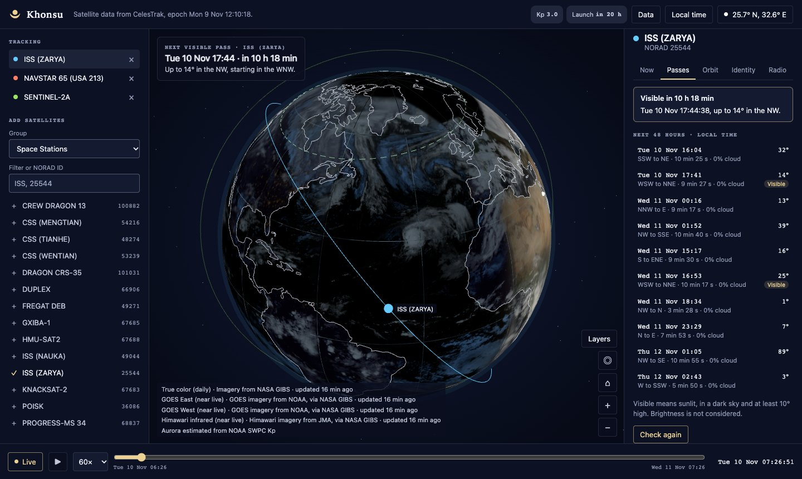

<p align="center"></p>

# Khonsu

**Follow what crosses the sky.** Khonsu tracks satellites on a live 3D globe, tells you when you can see them, and explains what they are, what they transmit and what they see. It's a single Go binary with a web app, a terminal UI and a scriptable CLI.

Khonsu is named after the ancient Egyptian moon god, whose name is usually read as "traveller". It was previously called TLEGO.



[Get started](#get-started) · [Web app](#web-app) · [Terminal UI](#terminal-ui) · [Command line](#command-line) · [Data sources](#data-sources) · [Development](#development)

## What you get

- **A live globe in your browser.** Follow up to eight satellites over a globe with real day and night, then scrub ahead or share the view as a link.
- **Each satellite's story.** Who runs it and when it launched, what it transmits and on which frequencies, and the latest pictures from Earth-imaging satellites.
- **The planet and space weather.** Drape yesterday's true-color Earth or near-live clouds on the globe, see an aurora estimate from NOAA's Kp index, and check the next launch.
- **When to look up.** Passes for your location over the next 48 hours, which ones you can see, and whether clouds are in the way.
- **Terminal and scripts.** A keyboard-driven TUI, versioned JSON from the CLI, self-contained HTML orbit viewers and executable extensions.
- **Runs on your machine.** No account needed. Khonsu keeps a local copy of what it downloads, credits every source, and only sends your location when you ask for cloud cover.

## Get started

Download a binary from [GitHub Releases](https://github.com/Mohammed-Ashour/khonsu/releases/latest), or install with Go 1.23.1 or newer:

```bash
go install github.com/Mohammed-Ashour/khonsu@latest
khonsu web
```

From a checkout, `make install` and `make web` do the same, and `make help` lists the rest. If your shell can't find `khonsu`, add `$(go env GOPATH)/bin` to `PATH`.

Everything works without setup. To connect an optional free [Space-Track](https://www.space-track.org/auth/createAccount) account and save your location, run `khonsu setup` and press Enter to skip any question.

## Web app

`khonsu web` starts a local server and opens your browser. The app is built into the binary, so it needs no Node and loads nothing from other sites.

| Want to… | Do this |
|---|---|
| Follow satellites | Add them from a group, a filter or a NORAD ID |
| Learn about one | Open **Identity**, **Radio** or **Sees** (for Sentinel-2 and Landsat) in the inspector |
| Find a pass | Set your location, then open **Passes** for sky plots, a Visible badge and **Check clouds near me** |
| Change the globe | Press **Layers** for true color, near-live clouds and the aurora estimate |
| Check the sky | Open the **Kp** and **Launch** chips in the top bar |
| Look ahead | Scrub or play the timeline, then press **Live** to return |
| Share a view | Send the URL, which holds the satellites but never your location |

Each tab asks its provider only when you open it, and the **Data** button lists every source with its credit. Run `khonsu web --file examples/tui-demo/iss.tle` from a checkout to try it with no provider requests. The [web app guide](docs/web-app.md) covers privacy, limits and the JSON API.

## Terminal UI

[](assets/tui-demo.mp4)

```bash
khonsu tui                         # browse groups
khonsu tui --norad 25544           # open the ISS
go run ./examples/tui-demo         # offline demo from a checkout
```

Explore, Detail, Track, Predict and Reports cover finding a satellite, reading its orbit, following it, looking ahead and exporting text, JSON or CSV. Press `?` for keys. Set your observer in Settings to get passes. [TUI notes](docs/tui-spec.md) cover keys, cache and settings.

## Command line

| Command | What it does |
|---|---|
| `khonsu tonight --lat 51.48 --lon 0` | List naked-eye ISS passes in the next dark period |
| `khonsu passes --lat 51.48 --lon 0 25544` | Estimate passes for any satellite |
| `khonsu predict --time 2026-10-24T05:01:11Z 25544` | Predict a position |
| `khonsu report 25544 --format json` | Generate a versioned JSON report |
| `khonsu search starlink` | Search names and IDs |
| `khonsu list --sat-group "Space Stations"` | Fetch a group's elements |
| `khonsu viz 25544` | Write a self-contained 3D orbit viewer to `25544.html` |
| `khonsu setup` | Connect optional accounts and save your location |

Position, report and pass commands accept `--file` for offline TLE or GP JSON input, and `--format json` for machine output. Run `khonsu --help` for everything else. More detail: [visibility estimates](docs/visibility.md), [element formats](docs/gp-elements.md), [the orbit viewer](docs/visualization.md) and [extensions](docs/extensions.md), such as turning passes into a calendar.

## Data sources

| What | From |
|---|---|
| Orbits | [CelesTrak](https://celestrak.org/), and [Space-Track](https://www.space-track.org/) with your own account |
| Missions | [Wikidata](https://www.wikidata.org/) and [GCAT](https://planet4589.org/space/gcat/) by Jonathan McDowell |
| Space weather | [NOAA SWPC](https://www.swpc.noaa.gov/), [CelesTrak](https://celestrak.org/SpaceData/) and [NASA DONKI](https://ccmc.gsfc.nasa.gov/tools/DONKI/) |
| Earth imagery | [NASA GIBS](https://nasa-gibs.github.io/gibs-api-docs/) with GOES and Himawari, and [Element 84 Earth Search](https://element84.com/earth-search/) |
| Sky, radio and launches | [Open-Meteo](https://open-meteo.com/), [SatNOGS DB](https://db.satnogs.org/) and [The Space Devs](https://thespacedevs.com/) |

Your copy of Khonsu fetches this data at runtime and credits it on screen. Khonsu doesn't bundle or redistribute it.

## Limits

- Passes are geometric estimates found at one-minute steps, so a very short pass can be missed. Brightness isn't considered. See [visibility estimates](docs/visibility.md).
- Predictions drift as orbital elements age, so Khonsu shows when they were last updated.
- Newer objects have catalog numbers too long for TLE text. Khonsu uses GP JSON throughout, and only `khonsu tle` is limited.

## Development

```bash
make test        # Go tests
make test-web    # web app tests (needs Node)
go vet ./...
```

CI runs on Linux, macOS and Windows. The web app's source is in `internal/webui/src`, and its built copy in `internal/webui/dist` must be rebuilt and committed (`cd internal/webui && npm run build`). Read [ARCHITECTURE.md](ARCHITECTURE.md) for package boundaries and [releasing](docs/releasing.md) for tags. Start new behavior from an [issue](https://github.com/Mohammed-Ashour/khonsu/issues). The [roadmap](https://github.com/Mohammed-Ashour/khonsu/labels/khonsu-roadmap) tracks where Khonsu is heading.

<details>
<summary>Coming from TLEGO</summary>

- Install from `github.com/Mohammed-Ashour/khonsu`. The command is now `khonsu`, and release archives are named `khonsu_*`.
- TUI settings and the web app's saved location and time zone carry over automatically. The catalog cache starts empty and refills on demand.
- Rename extension executables from `tlego-<name>` to `khonsu-<name>`. They now receive `KHONSU_HOST_VERSION` and `KHONSU_EXTENSION_VERSION`.
- JSON output is still schema 1.0, with the same fields.

</details>

## License

Khonsu is available under the [MIT license](LICENSE.md). Propagation uses [go-satellite-v2](https://github.com/Mohammed-Ashour/go-satellite-v2), the TUI uses [Bubble Tea](https://github.com/charmbracelet/bubbletea), commands use [urfave/cli](https://github.com/urfave/cli), and the web app and orbit viewer use [Three.js](https://threejs.org/) and [Natural Earth](https://www.naturalearthdata.com/).
