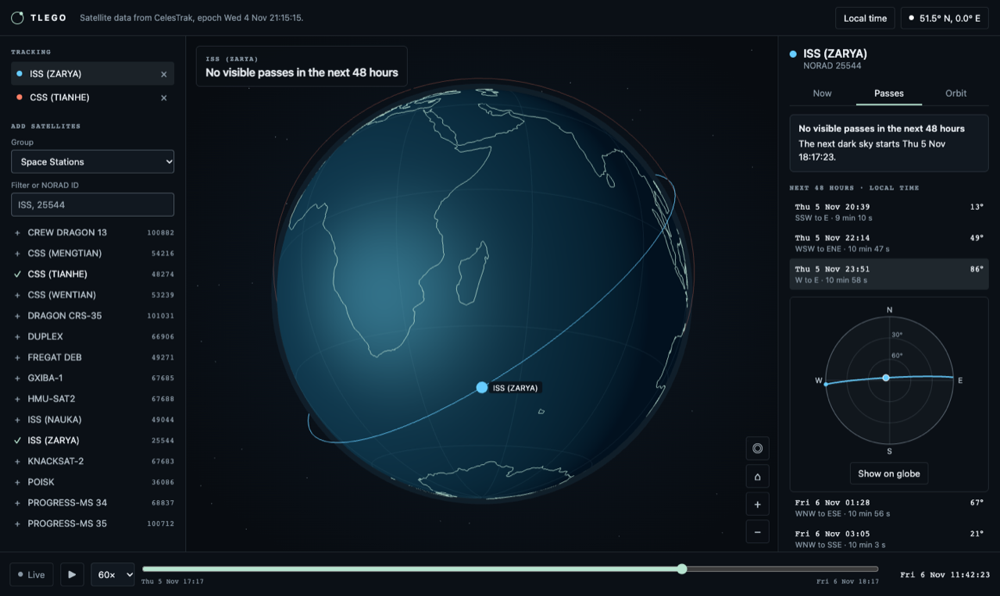
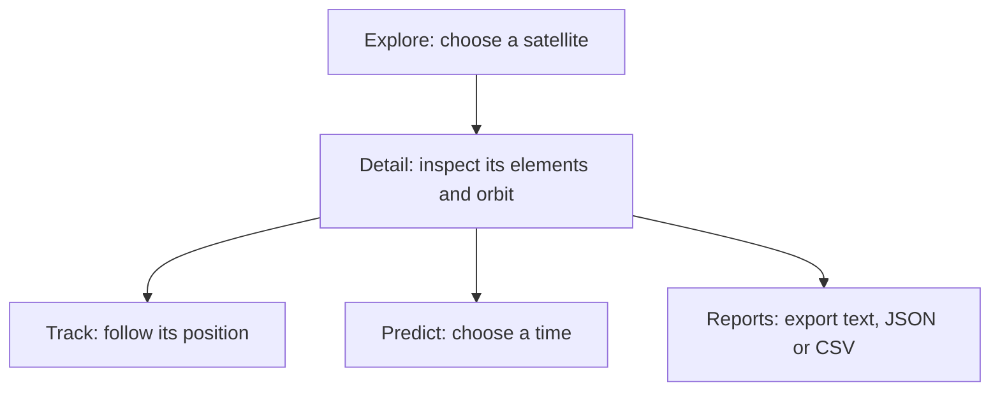
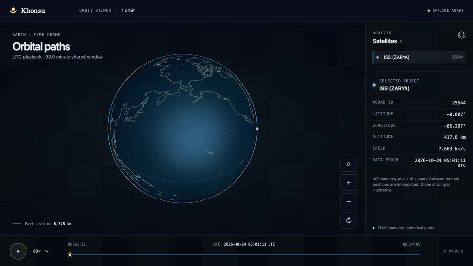

<p align="center"></p>

# Khonsu

Follow what crosses the sky. Browse satellites, track them on a live 3D globe, and find out when you can see them. Khonsu is a single Go binary with a web app, a keyboard-driven terminal UI, a scriptable CLI and HTML orbit exports, using CelesTrak data.

Khonsu is named after the ancient Egyptian moon god, whose name is usually read as "traveller". The project was previously called TLEGO; see [Coming from TLEGO](#coming-from-tlego). It is growing into a satellite explorer that teaches you about orbits and data as you use it. The [roadmap](https://github.com/Mohammed-Ashour/khonsu/labels/khonsu-roadmap) tracks that work.

[](assets/tui-demo.mp4)

*An offline ISS walkthrough using a saved 2026-10-24 element set.* [Download the MP4](https://github.com/Mohammed-Ashour/khonsu/raw/refs/heads/main/assets/tui-demo.mp4) · [Run or record the demo](docs/demos/README.md)

[Get started](#get-started) · [Web app](#web-app) · [See the ISS tonight](#see-the-iss-tonight) · [Try it offline](#try-it-offline) · [Use the TUI](#use-the-tui) · [CLI commands](#cli-commands) · [Development](#development)

## Get started

Download a binary from [GitHub Releases](https://github.com/Mohammed-Ashour/khonsu/releases/latest), or install with Go 1.23.1 or newer:

```bash
go install github.com/Mohammed-Ashour/khonsu@latest
```

From a checkout, `make install` does the same, and `make help` lists the other commands.

Khonsu works without any setup. To connect an optional [Space-Track](https://www.space-track.org/auth/createAccount) account and save your location, run the step-by-step wizard:

```bash
khonsu setup     # or: make setup, from a checkout
```

Press Enter to skip any question. [The web app guide](docs/web-app.md#space-track-account) explains how the account is stored.

Then start the terminal UI:

```bash
khonsu tui
```

If your shell cannot find a `go install` binary, add Go's binary installation directory to `PATH`. By default, this is the `bin` directory under `go env GOPATH`, unless you set `GOBIN`.

Open the ISS directly or choose a satellite group:

```bash
khonsu tui --norad 25544
khonsu tui --group "Space Stations"
```

These commands fetch live data when a usable cache is unavailable. To see the interface without provider access, use the offline example below.

## Web app

```bash
khonsu web
```



This starts a local server and opens your browser. Everything is in the binary, so it needs no Node and loads nothing from other sites.

| Want to… | Do this |
|---|---|
| Follow satellites | Add up to eight from a group, a filter or a NORAD ID, and watch them on a globe with real day and night |
| See where to look | Set your location to get direction and elevation, and a line to the satellite while it is up |
| Find a pass | Open Passes for the next 48 hours, with a countdown, sky plots and a badge on the ones you can see |
| Look ahead | Scrub or play through the next day, then press Live to return |
| Share a view | Send the URL, which holds the satellites but never your location |

Use `khonsu web --no-open --addr 127.0.0.1:9000` to choose the address yourself. To try it without provider access, run `go run . web --file examples/tui-demo/iss.tle` from a checkout.

The first load of a group waits for CelesTrak. After that, its satellites appear at once. The [web app guide](docs/web-app.md) covers the options, privacy, limits and the JSON API.

## See the ISS tonight

```bash
khonsu tonight --lat 51.48 --lon 0
```

With the saved ISS snapshot, adding `--file examples/tui-demo/iss.tle --time 2026-10-24T12:00:00Z --utc` from a checkout prints:

```text
ISS (ZARYA) (25544) from 51.4800°, 0.0000°
Dark sky: Sat 24 Oct 17:23 UTC to Sun 25 Oct 06:07 UTC

Sun 25 Oct  visible for 3m 25s
  appears  04:37:11  84° above NW
  highest  04:37:16  86° above N
  ends     04:40:36  11° above E
```

Pass another catalog ID to check a different satellite. If you have saved an observer in the TUI's Settings, you can leave out `--lat` and `--lon`. [Visibility estimates](docs/visibility.md) explain the criteria and limits.

## Try it offline

```bash
git clone https://github.com/Mohammed-Ashour/khonsu.git
cd khonsu
go run ./examples/tui-demo
```

This runs the same TUI shown in the animation. It uses an embedded ISS snapshot, a Greenwich observer, and temporary cache/settings directories. Network requests are blocked. Your regular configuration stays untouched.

The snapshot is archived; displayed positions use your machine's current clock. Use it to explore the interface, then run `khonsu tui` for current data. The first `go run` may download Go dependencies even though the example itself makes no provider requests.

<a id="terminal-ui"></a>

## Use the TUI

Start in Explore, choose a satellite, then follow the workflow you need:



| Want to… | Start here |
|---|---|
| Find a satellite | Explore, then `/` to search by name or catalog ID |
| Inspect its orbit | Detail, with tabs for summary, elements, orbit, ground track and passes |
| Follow its position | Track, then Space to start or stop updates |
| Look ahead | Predict, then enter `+2h`, `+0.5d` or an RFC3339 timestamp |
| Save a report | Reports, choose a format, generate, then save |
| Estimate local passes | Settings to set your observer, then Detail → Passes and p; n picks a pass for the sky view |

### Keyboard essentials

| Keys | Action |
|---|---|
| Left/Right or h/l | Switch screens outside text fields |
| Tab / Shift+Tab | Move between lists, fields and inputs |
| Enter | Search, open a selection, or submit a prediction |
| Escape | Leave a text field so navigation keys work again |
| q / Ctrl+C | q returns Home, then exits; Ctrl+C exits anywhere |
| ? / Page Up / Page Down | Show help / scroll long content |

On Reports, f changes format, r generates, Tab edits the save path, and s saves after you leave the field. In Settings, Ctrl+S saves. Observer altitude is in km.

`khonsu tui --track 25544` opens Track; Space starts updates. `khonsu tui --screen Settings` opens observer settings directly. The default observer is 0° latitude, 0° longitude, so configure a location before using passes.

### Cache and settings

CLI, TUI and HTTP retrieval share validated elements in the platform user cache directory under `khonsu`. If a refresh fails, it can use a valid stale cache and displays a warning. r reloads through the cache and respects its TTL; it does not force a provider download.

Settings and recent satellites live in the platform user configuration directory under `khonsu/tui.yaml`. An absolute `XDG_CONFIG_HOME` overrides the settings directory. [TUI implementation notes](docs/tui-spec.md) cover paths, startup options and behavior in detail.

## Satellite element formats

Live commands request CelesTrak GP JSON and retain catalog IDs up to nine digits. Local files accept legacy TLE or GP JSON, including a single OMM object or a one-object array:

```bash
khonsu predict --file satellite.json --time 2026-10-24T05:01:11Z --format json
khonsu report --file satellite.json --format json
khonsu list --sat-group "Space Stations" > stations.json
```

Existing TLE files and caches still work. `khonsu tle` exports original legacy TLE text and cannot represent larger IDs. [Supported fields, compatibility and numerical checks](docs/gp-elements.md) explain the GP JSON contract.

## CLI commands

CLI, TUI, HTTP and orbit exports use the same orbital core, with UTC calculations and degree-valued geographic coordinates. Use `--format json` with predict, report, passes or tonight for versioned machine output.

| Command | What it does |
|---|---|
| `khonsu tle 25544` | Fetch the ISS element set |
| `khonsu list --sat-group "Space Stations"` | Fetch a configured group's elements, ignoring case |
| `khonsu search starlink` | Search names and IDs with partial-coverage warnings |
| `khonsu predict --time 2026-10-24T05:01:11Z 25544` | Predict a position |
| `khonsu report 25544 --format json` | Generate a versioned JSON report |
| `khonsu tonight --lat 51.48 --lon 0` | List naked-eye ISS passes in the next dark period |
| `khonsu passes --lat 51.48 --lon 0 25544 --format json` | Estimate passes for an observer |
| `khonsu plugin list` | Inspect executable extensions on PATH |
| `khonsu viz 25544` | Write a self-contained orbit viewer to `25544.html` |
| `khonsu web` | Open the web app in your browser |
| `khonsu server` | Start the JSON API and the older experimental UI from a checkout |
| `khonsu --help` | List all commands; add `--help` to a command for its options |

All frontends use the shared catalog and cache, with validated atomic replacement and stale fallback. CLI retrieval supports `--cache-dir` and `--cache-ttl`. Position, report and pass commands accept `--file path.tle` or `--file -` for offline input. The experimental server binds `127.0.0.1:8080` by default; `--addr` changes the address, and `--static-dir` selects the checkout UI directory.

### Orbit viewer

[](assets/orbit-demo.mp4)

[Download the orbit walkthrough MP4](https://github.com/Mohammed-Ashour/khonsu/raw/refs/heads/main/assets/orbit-demo.mp4). [Static preview](assets/orbit-demo.jpg). This recording uses the saved ISS snapshot at its 2026-10-24 epoch.

Fetch the ISS and export its orbit:

```bash
khonsu viz 25544 --output iss-orbit.html
```

From a checkout, generate the same view as the video without a provider request:

```bash
go run . viz --file examples/tui-demo/iss.tle --output iss-orbit.html
```

Open the HTML in a WebGL 2-capable browser. The exported file includes its renderer, styles, geography and orbit samples, so it needs no external assets. Drag to orbit the camera, scroll to zoom, or use the camera buttons. Play/Pause, speed and the UTC slider control the sampled timeline.

Local files may contain multiple satellites. `--time` chooses a shared RFC3339 start; `--points` controls samples per orbit. Without `--time`, live lookups start now and local files start at their first element's epoch. Playback begins paused and stays inside the shared sample interval.

The globe and trajectories use the same physical scale. Lighting is illustrative, the globe is spherical, and between-sample positions are interpolated. [Visualization guide](docs/visualization.md) explains the limits and compatibility changes.

## Current limits and next steps

- CelesTrak stopped issuing 5-digit catalog numbers in July 2026, and newer objects have no TLE data. Live commands already use GP JSON and work with these IDs; only `khonsu tle` is limited to legacy TLE text.
- Passes are found at one-minute steps and refined to one second, so a shorter pass can be missed. Clipped forecast boundaries are marked. `khonsu tonight` estimates naked-eye visibility without brightness or weather. Precision antenna control is not calculated.
- Orbit classes use declared period, shape and altitude criteria; apogee and perigee are two-body estimates. [Criteria, reference checks and limits](docs/orbit-estimates.md) explain their meaning.
- TUI `json` reports retain their legacy format. Select `json-v1` for the versioned report contract. [Core and extension documentation](docs/extensions.md) describes the JSON schema, compatibility and executable extensions.

## Extensions

Create a standalone project with `khonsu plugin init summary` or `khonsu plugin init summary --language python`. The [extension authoring guide](docs/writing-extensions.md) covers the generated code, tests and PATH installation.

An executable named `khonsu-calendar` on PATH runs as `khonsu calendar`. Native commands take precedence, and arguments and streams pass directly to the extension.

The [Python calendar example](examples/calendar/README.md) turns pass-plan JSON into an iCalendar file:

```bash
khonsu passes --file examples/tui-demo/iss.tle --time 2026-10-24T05:01:11Z \
  --lat 51.48 --lon 0 --format json | khonsu calendar > passes.ics
```

Install the example first using its README. [Extension authoring and output schema](docs/extensions.md) covers discovery, failure codes and versioning.

[Browse the backlog](https://github.com/Mohammed-Ashour/khonsu/issues) for the current priorities and acceptance criteria.

## Coming from TLEGO

- Install from `github.com/Mohammed-Ashour/khonsu`. The command is now `khonsu`, and release archives are named `khonsu_*`.
- TUI settings and the web app's saved location and time zone choice carry over automatically. The catalog cache starts empty and refills on demand.
- Rename extension executables from `tlego-<name>` to `khonsu-<name>`. They now receive `KHONSU_HOST_VERSION` and `KHONSU_EXTENSION_VERSION`.
- JSON output is still schema 1.0, with the same fields.

## Development

From a checkout:

```bash
go build -o bin/khonsu .
go test ./...
go vet ./...
```

CI builds and tests on Linux, macOS and Windows. Use `go test -race ./...` when changing concurrent behavior on a supported platform.

Read [ARCHITECTURE.md](ARCHITECTURE.md) for the current package boundaries, [the TUI notes](docs/tui-spec.md) for interaction behavior, and [the recording guide](docs/demos/README.md) to update the walkthrough. [Publishing a release](docs/releasing.md) covers tagging and package managers. Keep pull requests focused and include the relevant checks. For new behavior, start from a tracked issue or describe the proposed change in the PR.

## Data, dependencies and license

Satellite elements come from [CelesTrak](https://celestrak.org/). The web app fetches and credits data from [NOAA SWPC](https://www.swpc.noaa.gov/), [NASA DONKI](https://ccmc.gsfc.nasa.gov/tools/DONKI/), [CelesTrak](https://celestrak.org/SpaceData/), [Wikidata](https://www.wikidata.org/), [GCAT](https://planet4589.org/space/gcat/) by Jonathan McDowell, [Space-Track](https://www.space-track.org/) with your own account, [SatNOGS DB](https://db.satnogs.org/), [The Space Devs](https://thespacedevs.com/), [NASA GIBS](https://nasa-gibs.github.io/gibs-api-docs/) with GOES and Himawari imagery, [Element 84 Earth Search](https://element84.com/earth-search/) and [Open-Meteo](https://open-meteo.com/). Khonsu displays this data and doesn't redistribute it. Propagation uses [go-satellite-v2](https://github.com/Mohammed-Ashour/go-satellite-v2); the TUI uses [Bubble Tea](https://github.com/charmbracelet/bubbletea), commands use [urfave/cli](https://github.com/urfave/cli), and the web app and orbit viewer use [Three.js](https://threejs.org/) and [Natural Earth](https://www.naturalearthdata.com/) outlines.

Khonsu is available under the [MIT license](LICENSE.md).
