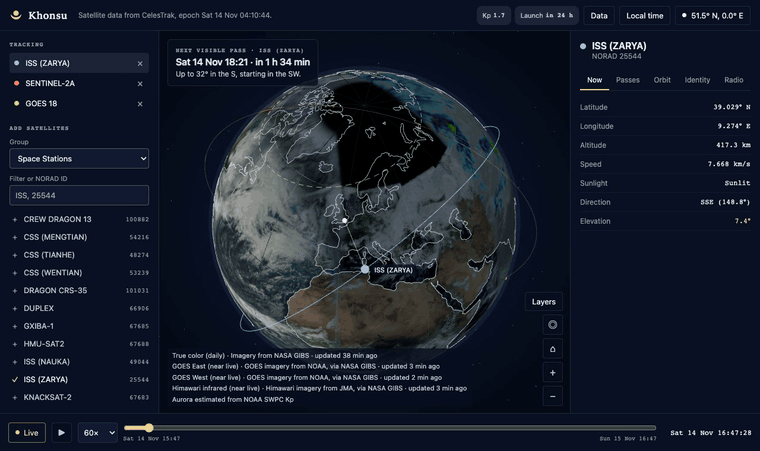
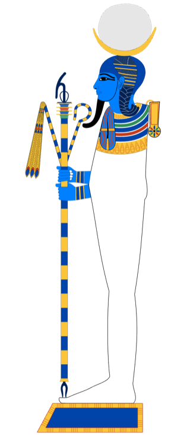
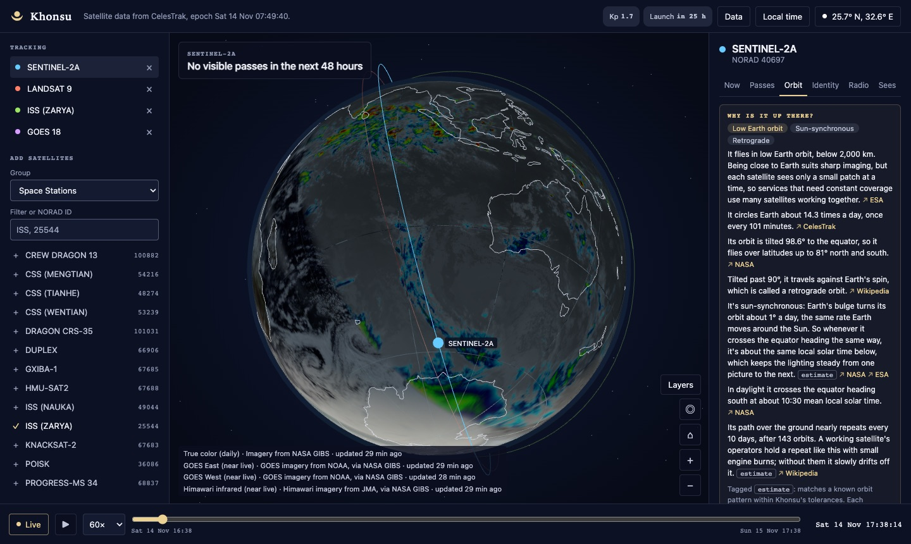
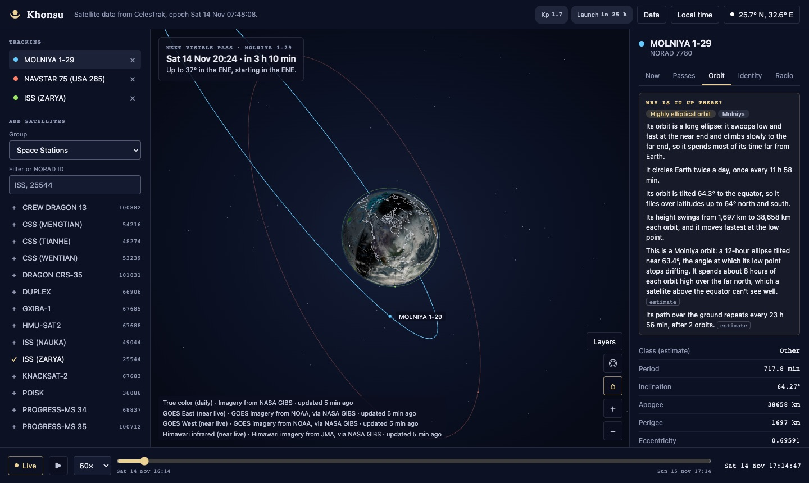
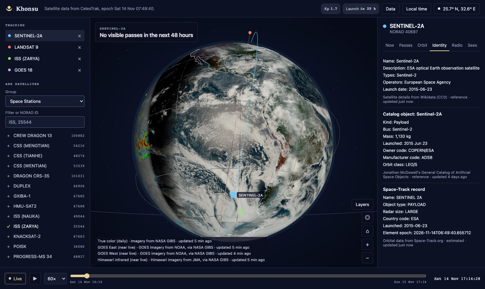
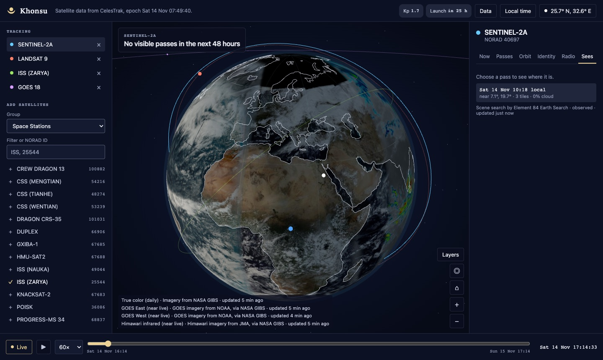

<p align="center"></p>

<h1 align="center">Khonsu</h1>

<p align="center">
  <b>Follow what crosses the sky.</b><br>
  Know when to look up, what you're looking at, and why it's up there.
</p>

<p align="center">
  <a href="#get-started">Get started</a> ·
  <a href="#what-you-can-do">What you can do</a> ·
  <a href="#where-the-data-comes-from">Data</a> ·
  <a href="#development">Development</a>
</p>

<p align="center">
  <a href="assets/web-demo.mp4"></a>
</p>



Satellites cross your sky every night, but most trackers only give you numbers. Khonsu turns those numbers into answers:

- **A moment to look up.** It tells you when a satellite will pass over you, whether you'll be able to see it, and whether clouds will be in the way.
- **An understanding of what you see.** It explains in plain words why each orbit is the way it is, and links every sentence to a source.
- **A view of the planet they watch.** See today's clouds, yesterday's Earth and the aurora estimate, and find where Sentinel-2 and Landsat recently captured scenes.
- **Tools you own.** Khonsu is one program that runs on your computer, with a web app, a terminal app and a command line. It needs no account.

Khonsu was the ancient Egyptian god of the Moon. His name means "traveller", which may refer to the Moon's nightly journey across the sky ([Wikipedia](https://en.wikipedia.org/wiki/Khonsu)). This project follows newer travellers along the same path. It was previously called TLEGO.

<sub>Drawing: <a href="https://commons.wikimedia.org/wiki/File:Khonsu_(azure_skin_color).svg"><i>Khonsu (azure skin color)</i></a> by UWMKEgypt, <a href="https://creativecommons.org/publicdomain/zero/1.0/">CC0</a>, via Wikimedia Commons.</sub>

<br clear="right">

## Get started

Download a binary from [GitHub Releases](https://github.com/Mohammed-Ashour/khonsu/releases/latest), or install it with Go 1.23.1 or newer:

```bash
go install github.com/Mohammed-Ashour/khonsu@latest
khonsu web          # opens the app in your browser
```

No account is required. To save a location for terminal pass estimates, or to connect an optional free [Space-Track](https://www.space-track.org/auth/createAccount) account, run `khonsu setup`, and press Enter to skip any question. The web app keeps its own location in your browser. From a checkout, `make install` and `make web` do the same, and `make help` lists the rest.

## What you can do

### See the ISS tonight

Ask when the International Space Station will next be sunlit in your dark sky, a *viewing window* when you might see it. This example uses Greenwich, London:

```console
$ khonsu tonight --lat 51.48 --lon 0
ISS (ZARYA) (25544) from 51.4800°, 0.0000°
Dark sky: Sat 14 Nov 16:49 GMT to Sun 15 Nov 06:41 GMT

Sat 14 Nov  visible for 2m 25s
  appears  18:21:21  10° above SW
  highest  18:23:46  32° above S
  fades    18:23:46  32° above S
```

In the web app, set your location and open **Passes**. You get a countdown to the next viewing window, a sky plot of where to look, and a *Window* badge on each pass that is sunlit in a dark sky. Brightness, weather and obstructions may still prevent a sighting. **Check clouds near me** adds the forecast cloud cover for each one. `khonsu passes` does the same for any satellite.

### Understand why a satellite flies where it does

Select a satellite and open **Orbit**. *Why is it up there?* explains its orbit in plain words: how high and how fast it flies, how far north and south it reaches, and patterns like sun-synchronous or Molniya. It also gives the local time it crosses the equator and how often its path repeats. Each sentence links to its source, and best guesses are tagged *estimate*.

<table>
  <tr>
    <td width="50%"></td>
    <td width="50%"></td>
  </tr>
  <tr>
    <td>Sentinel-2A crosses the equator at 10:30 local solar time and repeats its path every 10 days, as <a href="https://sentiwiki.copernicus.eu/web/s2-mission">Copernicus publishes</a>.</td>
    <td>A Molniya orbit's 12-hour ellipse lingers high over the far north, a region a satellite above the equator can't see well (<a href="https://science.nasa.gov/earth/earth-observatory/catalog-of-earth-satellite-orbits/">NASA</a>).</td>
  </tr>
</table>

The same explanation comes with every report:

```console
$ khonsu report 40697
...
Why It's Up There (Low Earth orbit):
- It circles Earth about 14.3 times a day, once every 101 minutes.
  Sources: CelesTrak, FAQs: Two-Line Element Set Format <https://celestrak.org/columns/v04n03/>
- In daylight it crosses the equator heading south at about 10:30 mean local solar time.
  Sources: NASA, Catalog of Earth Satellite Orbits <https://science.nasa.gov/earth/earth-observatory/catalog-of-earth-satellite-orbits/>
- Its path over the ground nearly repeats every 10 days, after 143 orbits. (estimate)
...
```

### Meet the satellite, and find its scenes

**Identity** shows who runs a satellite, when it launched and what it's for. **Radio** lists what it transmits and on which frequencies. For Sentinel-2 and Landsat, **Scenes** lists the latest scenes they captured and turns the globe to the centre of each one. It shows where a scene was taken, not the picture itself.

<table>
  <tr>
    <td width="50%"></td>
    <td width="50%"></td>
  </tr>
  <tr>
    <td>Identity combines Wikidata, GCAT and, with your own account, Space-Track.</td>
    <td>Pick a recent scene, and the globe turns to where it was captured.</td>
  </tr>
</table>

### Watch the planet and the sky above it

Press **Layers** to drape yesterday's true-colour Earth or near-live clouds from GOES and Himawari over the globe. You can add an aurora estimate drawn from NOAA's Kp index. The **Kp** and **Launch** chips in the top bar show today's space weather and the next launch. Scrub the timeline to look ahead, then press **Live** to come back.


### Stay in the terminal

The terminal app does the same tracking without a browser. You can browse groups, follow a satellite, look ahead, and export reports as text, JSON or CSV.

[](assets/tui-demo.mp4)

```bash
khonsu tui --norad 25544      # open the ISS; press ? for keys
```

### Build on it

Every command can print versioned JSON, so Khonsu fits into scripts, notebooks and other tools:

```bash
khonsu report 40697 --format json | jq -r '.data.orbit.explanation.statements[].text'
khonsu passes --lat 51.48 --lon 0 25544 --format json | khonsu calendar > iss.ics   # passes in your calendar
khonsu viz 25544                                                                  # a 3D orbit page you can share
```

The calendar is an [extension](docs/extensions.md), a small program any language can provide. More: [the web app guide](docs/web-app.md), [visibility estimates](docs/visibility.md), [orbit estimates and their sources](docs/orbit-estimates.md), [element formats](docs/gp-elements.md) and [the orbit viewer](docs/visualization.md). Run `khonsu --help` for every command.

## Your data stays yours

- **No account needed.** Khonsu runs on your machine.
- **Your location stays local.** It's sent only when you ask for cloud cover, rounded to about 10 km. Shared links hold the satellites you follow but never your location.
- **Only what you open.** Each tab asks its provider only when you open it. Khonsu keeps a local copy of what it downloads.
- **Offline mode.** `khonsu web --file examples/tui-demo/iss.tle`, run from a checkout, makes no provider requests at all.

## Where the data comes from

| What | From |
|---|---|
| Orbits | [CelesTrak](https://celestrak.org/), and [Space-Track](https://www.space-track.org/) with your own account |
| Missions | [Wikidata](https://www.wikidata.org/) and [GCAT](https://planet4589.org/space/gcat/) by Jonathan McDowell |
| Space weather | [NOAA SWPC](https://www.swpc.noaa.gov/), [CelesTrak](https://celestrak.org/SpaceData/) and [NASA DONKI](https://ccmc.gsfc.nasa.gov/tools/DONKI/) |
| Earth imagery | [NASA GIBS](https://nasa-gibs.github.io/gibs-api-docs/) with GOES and Himawari, and [Element 84 Earth Search](https://element84.com/earth-search/) |
| Sky, radio and launches | [Open-Meteo](https://open-meteo.com/), [SatNOGS DB](https://db.satnogs.org/) and [The Space Devs](https://thespacedevs.com/) |
| Orbit explanations | ESA, NASA, CelesTrak, GPS.gov and others, linked from each sentence |

Your copy of Khonsu fetches this data at runtime and credits it on screen, under the **Data** button. Khonsu doesn't bundle or redistribute it.

## Limits

- Passes are geometric estimates found at one-minute steps, so a very short pass can be missed. Brightness isn't considered. See [visibility estimates](docs/visibility.md).
- Predictions drift as orbital elements age, so Khonsu shows when they were last updated.
- Orbit explanations are estimates from the elements. Their tolerances are documented in [orbit estimates](docs/orbit-estimates.md#why-its-up-there).
- Newer objects have catalog numbers too long for TLE text. Khonsu uses GP JSON throughout, and only `khonsu tle` is limited.

## Development

```bash
make test        # Go tests
make test-web    # web app tests (needs Node)
go vet ./...
```

CI runs on Linux, macOS and Windows. The web app's source is in `internal/webui/src`, and its built copy in `internal/webui/dist` must be rebuilt and committed (`cd internal/webui && npm run build`). Read [ARCHITECTURE.md](ARCHITECTURE.md) for package boundaries and [releasing](docs/releasing.md) for tags. Start new behaviour from an [issue](https://github.com/Mohammed-Ashour/khonsu/issues). The [roadmap](https://github.com/Mohammed-Ashour/khonsu/labels/khonsu-roadmap) tracks where Khonsu is heading.

<details>
<summary>Coming from TLEGO</summary>

- Install from `github.com/Mohammed-Ashour/khonsu`. The command is now `khonsu`, and release archives are named `khonsu_*`.
- TUI settings and the web app's saved location and time zone carry over automatically. The catalog cache starts empty and refills on demand.
- Rename extension executables from `tlego-<name>` to `khonsu-<name>`. They now receive `KHONSU_HOST_VERSION` and `KHONSU_EXTENSION_VERSION`.
- JSON output is still schema 1.0, with the same fields.

</details>

## License

Khonsu is available under the [MIT license](LICENSE.md). The software it builds on keeps its own licenses, listed in full in [THIRD_PARTY_NOTICES.md](THIRD_PARTY_NOTICES.md), which ships in every release archive.

- **Libraries:** propagation uses [go-satellite-v2](https://github.com/Mohammed-Ashour/go-satellite-v2), the TUI uses [Bubble Tea](https://github.com/charmbracelet/bubbletea), and commands use [urfave/cli](https://github.com/urfave/cli). The web app and orbit viewer use [Three.js](https://threejs.org/) and [Natural Earth](https://www.naturalearthdata.com/).
- **Drawing of Khonsu:** dedicated to the public domain ([CC0](https://creativecommons.org/publicdomain/zero/1.0/)) by its author on [Wikimedia Commons](https://commons.wikimedia.org/wiki/File:Khonsu_(azure_skin_color).svg).
