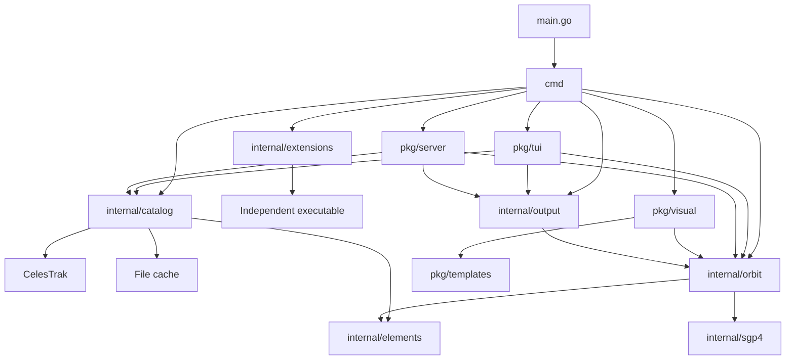

# TLEGO architecture, complexity, and design pattern review

Review date: 2026-10-27

Branch: `main`

Commit: `edd02fd89c22bf5443f77e6e702f62c94b13ce00`

Scope: Current repository code, including the Go application, browser code, and Python calendar example.

## 1. Review result

The main package boundaries are useful. The application does not need a rewrite.

The main design weakness is state ownership in the TUI. Related records, retrieval metadata, timers, and derived results have separate lifecycles. These separate lifecycles permit incorrect output.

The catalog has a second problem. It contains two cache workflows and several parsing responsibilities in one file. This structure increases the cost of each format change.

Four behavior defects were reproduced during this review:

1. A selected satellite can use retrieval metadata from another request.
2. Pass results remain after the observer changes.
3. A previous tracking timer can start another timer chain after tracking restarts.
4. The legacy public file parser can panic on malformed input.

Two additional checks confirmed duplicate downloads and partial search results with a cancellation error. Current search callers discard those partial results.

The existing tests pass, including race detection. Those tests do not cover all the state transitions above.

Use the existing core packages. Correct state ownership first. Then remove duplicate policy code.

## 2. Scope and method

The review used `ARCHITECTURE.md`, `README.md`, source files, tests, schema definitions, and CI configuration. Code evidence takes priority over architecture descriptions.

The review examined these paths:

- CLI command dispatch, input loading, and output.
- Catalog retrieval, cache replacement, stale fallback, and search.
- TLE and GP JSON parsing and validation.
- Propagator initialization, position calculation, orbit estimates, and pass sampling.
- TUI messages, navigation, selection, settings, tracking, and reports.
- HTTP handlers and the experimental browser client.
- Orbit sampling, HTML export, and viewer state.
- Extension discovery, process control, and project generation.
- The independent Python calendar consumer.

The review measured all application Go files across platforms. Generated JavaScript and retained numerical code received separate treatment.

Excluded items were hidden local artifacts, Git internals, installed packages, and generated dependency code. Live provider accuracy and browser rendering performance were not measured.

Recommendations are proposals. This review does not change application behavior or approve a new architecture decision.

### Writing rules

This report uses short sentences, active voice, and consistent technical terms. Instructions use the command form. Code identifiers remain unchanged.

The writing reference is [ASD-STE100 Issue 9](https://www.asd-ste100.org/assets/files/ASD-STE100_ISSUE9.pdf). A complete STE dictionary compliance check was not performed.

### Finding levels

| Level | Meaning |
|---|---|
| P1 | Incorrect results or a process failure. Correct these before extending the affected workflow. |
| P2 | A contained behavior, maintenance, or resource problem. Plan a focused correction. |
| P3 | An optional improvement with limited current impact. |

No P0 issue was established. Levels describe current code risk, not a change introduced by a pull request.

## 3. Architecture map

The application uses a layered structure within one executable. Executable extensions run in separate processes.



The diagram shows the main application dependencies. It omits compatibility adapters and most third-party imports.

### Boundary assessment

| Boundary | Assessment | Evidence |
|---|---|---|
| Frontends to core | Good | CLI, TUI, and HTTP use catalog and orbit packages. |
| Retrieval to calculation | Good | Catalog code does not import orbital calculation code. |
| Calculation to presentation | Good | Orbit code does not import a frontend or output encoder. |
| Transport to domain | Mostly good | JSON v1 has separate transport records. |
| TUI state ownership | Weak | One model owns selection, retrieval metadata, timers, settings, and output. |
| Parsing ownership | Mixed | GP parsing lives in elements; TLE parsing lives in catalog and legacy packages. |
| Compatibility ownership | Mixed | Several adapters share the core; the legacy parser still has independent behavior. |
| Extension isolation | Good | Extensions use process and JSON contracts instead of internal callbacks. |

No import cycle was found in the inspected application package graph. Go tests also compile that graph successfully.

## 4. Findings

### A1. P1: Selected records lose their retrieval metadata

Evidence: [model.go:255](../../../pkg/tui/model.go#L255), [model.go:284](../../../pkg/tui/model.go#L284), [model.go:765](../../../pkg/tui/model.go#L765), and [commands.go:162](../../../pkg/tui/commands.go#L162).

The TUI stores element records in `tleCache`. It stores one separate `currentMeta` value for the model.

Group loading replaces `currentMeta`. Search results store records without their individual retrieval metadata. Cached selection calls `setCurrentElement`, which does not replace `currentMeta`.

A later JSON v1 report uses that separate metadata value. Its retrieval time, cache status, and warning can describe another request.

A targeted check selected a search result after setting metadata from another group. The selected record retained the unrelated metadata.

This is an information ownership defect. A record and its retrieval metadata form one logical result.

Correction:

1. Store each record with its retrieval metadata.
2. Preserve that metadata through group and search results.
3. Select the complete result in one operation.
4. Derive report provenance from the selected result.

Do not add another global metadata map without an explicit update rule. That would preserve the coordination problem.

Acceptance check: Load groups with different retrieval times and cache states. Search, select, and export each record. Check each provenance field.

### A2. P1: Observer changes leave previous pass results active

Evidence: [model.go:829](../../../pkg/tui/model.go#L829), [model.go:969](../../../pkg/tui/model.go#L969), and [view.go:222](../../../pkg/tui/view.go#L222).

Pass calculation uses the current observer. The model stores only the resulting pass slice.

Settings save replaces the observer but does not clear the pass slice. The pass view continues to display those results without their original observer.

A targeted check changed latitude and saved settings. The previous pass slice remained active.

This defect can show predictions for the wrong location.

Correction:

1. Associate a pass result with its observer, element identity, time window, and sample step.
2. Clear the result when one of those inputs changes.
3. Display the observer and calculation window with the result.

Acceptance check: Calculate passes, change the observer, and return to the pass view. Require recalculation before displaying active results.

### A3. P1: The legacy public parser can panic

Evidence: [tle.go:191](../../../pkg/tle/tle.go#L191), especially [tle.go:212](../../../pkg/tle/tle.go#L212).

`pkg/tle.ReadTLEFile` reads `components[1]` before it validates line length or field count.

A file with the single line `2 ` causes an index panic. A standalone check reproduced this failure.

The active catalog parser validates structure before parsing. Thus, the same repository has two different parser contracts.

This defect affects callers of the public legacy parser. The active CLI input path uses the catalog parser.

Correction:

1. Check field count before index access.
2. Validate line pairing and matching IDs.
3. Move shared TLE parsing below the catalog package.
4. Retain public types through explicit conversion adapters.

Use a small immediate guard before the larger ownership change. Preserve exported types and signatures.

Acceptance check: Supply short lines, missing IDs, unmatched pairs, and incorrect numeric fields. Require errors without panics.

### A4. P2: Previous tracking timers can create duplicate timer chains

Evidence: [model.go:291](../../../pkg/tui/model.go#L291), [model.go:848](../../../pkg/tui/model.go#L848), and [commands.go:115](../../../pkg/tui/commands.go#L115).

Tracking messages contain only a time. They do not identify the tracking session that created them.

Stop tracking, then restart before the previous timer fires. The restart schedules a new timer. The previous timer then sees `trackRunning == true` and schedules another timer.

A targeted check reproduced the second schedule. This is an event ordering defect, so a passing race detector does not exclude it.

Repeated restarts can increase update frequency and duplicate trail points.

Correction:

1. Add a tracking session identifier to each tick.
2. Change the identifier when tracking stops, restarts, or changes satellite.
3. Ignore ticks from previous sessions.

Acceptance check: Start, stop, and restart before one timer interval. Deliver the previous tick. Verify that it schedules no work.

### A5. P2: TUI request replacement does not stop obsolete work

Evidence: [model.go:1122](../../../pkg/tui/model.go#L1122), [model.go:1138](../../../pkg/tui/model.go#L1138), and [commands.go:68](../../../pkg/tui/commands.go#L68).

Request identifiers prevent previous results from replacing newer state. This mechanism is useful and should remain.

However, network commands create contexts from `context.Background()`. Navigation changes the identifier but cannot cancel those contexts.

Previous requests can continue for 30 or 60 seconds. They can still download and replace cache files after the user leaves the workflow.

The program context in `RunContext` does not become the parent context of these catalog requests. Pass calculation also lacks a cancellation input.

This finding follows the context construction and call paths. It was not measured as a shutdown delay.

Correction:

1. Give the model a program context and an active request cancellation function.
2. Cancel the active request before replacement or navigation.
3. Pass its context into catalog commands.
4. Check cancellation during long calculation loops.
5. Keep request identifiers to reject results that arrive during cancellation.

Acceptance check: Block an HTTP transport, navigate away, and verify that the request context ends. Repeat during program exit.

### A6. P2: Search deadlines discard usable partial results

Evidence: [store.go:256](../../../internal/catalog/store.go#L256), [cmd/search.go:19](../../../cmd/search.go#L19), and [commands.go:95](../../../pkg/tui/commands.go#L95).

The catalog has 44 configured groups. Search retrieves them in sequence.

Both CLI and TUI callers set a 60-second search timeout. Individual provider requests can take up to 30 seconds.

When cancellation occurs, `SearchElements` returns accumulated records with an error. Both callers return the error without displaying those records.

A targeted check retrieved one group, then canceled the next request. The store returned one record with a cancellation error.

Thus, ordinary group failures permit partial output, but an overall deadline removes that output at the frontend.

Correction:

1. Define separate outcomes for user cancellation and incomplete search coverage.
2. Preserve usable records after a search deadline, if partial search remains the intended contract.
3. Include completion status and coverage in the result.
4. Consider limited concurrent retrieval after the result contract is clear.
5. Preserve deterministic result order and ID deduplication.

Do not start one unbounded worker for every group. Do not change explicit user cancellation into silent success.

Acceptance check: Return one successful group, one timeout, and one provider error. Verify records, coverage, warnings, and exit behavior.

### A7. P2: Catalog code duplicates the cache lifecycle

Evidence: [store.go:357](../../../internal/catalog/store.go#L357), [store.go:547](../../../internal/catalog/store.go#L547), and [store.go:594](../../../internal/catalog/store.go#L594).

GP JSON and TLE paths each implement cache inspection, freshness rules, retrieval, validation, replacement, and stale fallback.

The implementations already differ. GP JSON validates bytes before creating its temporary file. TLE validates the temporary file after writing it.

The GP path also handles legacy cache fallback. That format-specific rule is valid, but it makes the common lifecycle harder to identify.

`fetchElements` has a complexity estimate of 33 and five control nesting levels. The full store file has 908 lines.

This finding concerns duplicated policy and change cost. No additional cache corruption defect was established.

Correction:

1. Separate payload parsing from cache storage.
2. Keep one private cache lifecycle for fresh, fetched, stale, and failed outcomes.
3. Supply a typed payload decoder to that lifecycle.
4. Keep legacy fallback as an explicit rule around the common lifecycle.
5. Share atomic file replacement where requirements match.

A private generic function or a small typed helper is sufficient. A provider framework is unnecessary for the current single-provider application.

Acceptance check: Apply the same cache scenarios to both formats. Include malformed refresh, wrong ID, cancellation, and replacement failure.

### A8. P2: Concurrent cache misses duplicate provider requests

Evidence: [server.go:143](../../../pkg/server/server.go#L143) and [store.go:382](../../../internal/catalog/store.go#L382).

The HTTP handler shares one store. The store has no per-key coordination between cache inspection and retrieval.

A targeted check sent four concurrent requests for the same uncached ID. The store sent four provider requests.

Atomic rename protects file replacement. It does not prevent repeated downloads or parsing.

This finding concerns concurrent misses and expiry. Normal fresh cache hits do not contact the provider.

Correction:

1. Coordinate active refreshes by cache key.
2. Recheck the cache after acquiring coordination.
3. Keep different keys independent.
4. Define how canceled callers stop waiting without canceling unrelated callers.

Do not hold one global lock during all downloads. Start with process-local coordination. Add cross-process coordination only if measurements require it.

Acceptance check: Request one missing ID concurrently. Require one active refresh. Then verify independent IDs and canceled waiters.

### A9. P2: The experimental browser client accepts obsolete responses

Evidence: [public/index.html:171](../../../public/index.html#L171), [public/index.html:188](../../../public/index.html#L188), and [public/index.html:278](../../../public/index.html#L278).

Group and satellite changes start asynchronous requests. Each completed request updates the same dropdowns and scene.

The client has no request identifier or abort controller. A previous request can complete after a newer selection and restore previous data.

The client also parses responses without checking `response.ok`. Several server error paths return plain text. Those responses cause JSON parsing failures.

The conclusion follows the browser call paths. A browser interaction test was not run.

Correction:

1. Associate requests with the current selection.
2. Abort previous requests when selection changes.
3. Reject responses with previous selection identifiers.
4. Check the HTTP status before parsing the body.
5. Show a failure state without replacing the last valid scene.

Acceptance check: Complete two selection requests in reverse order. Verify that the newer selection remains active. Repeat with a non-JSON error response.

### A10. P2: Report save does not preserve an existing file on write failure

Evidence: [model.go:933](../../../pkg/tui/model.go#L933) and [model.go:1049](../../../pkg/tui/model.go#L1049).

The report save path calls `os.WriteFile` directly. That operation truncates an existing file before all new data is written.

If the write fails, the previous report can be empty or incomplete. The UI displays a failure but cannot restore the old file.

Settings, catalog cache, and HTML export already use temporary files and rename. Report save has a weaker replacement contract.

This finding follows filesystem call semantics. A disk-full failure was not injected.

Correction:

1. Write the report to a temporary file in the destination directory.
2. Close the file and check errors.
3. Replace the destination only after a successful write.
4. Remove the temporary file after failure.

Acceptance check: Inject a write or close failure. Verify that an existing report retains its original bytes.

## 5. Complexity results

### Measured inventory

| Measure | Result |
|---|---:|
| Non-test Go files | 60 |
| Go test files | 29 |
| Go package directories, including examples | 22 |
| Non-test Go physical lines | 8,457 |
| Function and method declarations with bodies | 323 |
| Median cyclomatic estimate | 3 |
| Declarations with estimate at least 15 | 24 |
| Declarations with estimate at least 20 | 13 |
| Named fields in `tui.Model` | 48 |

The TUI model and catalog store contain 2,063 lines. Together, they contain 24.4% of non-test Go lines.

The counts include comments, blank lines, examples, and platform-specific files. They exclude Go test contents from function complexity measurements.

### Functions that need attention

| Function | Physical lines | Complexity estimate | Control nesting | Assessment |
|---|---:|---:|---:|---|
| `catalog.validateNumericTLEFields` | 90 | 42 | 2 | Many field checks. Reduce duplicate parsing before splitting checks. |
| `elements.parseObject` | 102 | 34 | 3 | Field extraction and domain conversion share one function. |
| `tui.Model.Update` | 125 | 34 | 3 | Framework dispatch plus state changes. State ownership is the main risk. |
| `catalog.Store.fetchElements` | 103 | 33 | 5 | Retrieval, validation, persistence, and fallback are nested together. |
| `visual.WriteHTMLVisual` | 76 | 31 | 3 | Validation and export orchestration share one function. |
| `elements.FromTLE` | 55 | 24 | 2 | Conversion must preserve exact epoch and numeric semantics. |
| `cmd.visualizeSatelliteOrbit` | 79 | 24 | 2 | Source handling and export preparation share one action. |
| `catalog.validateTLEPayload` | 60 | 23 | 4 | The parser represents line-pair state with separate variables. |
| `tui.Model.updateExplore` | 89 | 22 | 4 | Input focus, cache selection, and network requests interact. |
| `extensions.Discover` | 68 | 22 | 4 | Platform and PATH rules account for much of the branching. |
| `tui.Model.View` | 70 | 22 | 1 | Mostly explicit presentation choices. Lower refactor priority. |
| `sgp4.sgp4` | 224 | 20 | 3 | Retained numerical implementation. Preserve source comparison. |

See [complexity.csv](complexity.csv) for all measured declarations.

### Metric limits

The estimate starts at one. Each `if`, `for`, and `range` adds one. Each non-default switch or select clause adds one.

Each `&&` or `||` also adds one. Counts include anonymous functions inside the enclosing declaration. Those functions do not receive separate rows.

Control nesting counts nested conditions, loops, switches, and selects. It excludes the function body and clause blocks. An `else if` counts as nested.

This method is a source estimate. It is not cognitive complexity or a complete control-flow analysis.

Use the numbers to select review targets. Do not use them as automatic failure limits. Validation and numerical code can require many independent checks.

### The useful structural changes

The TUI model needs cohesive state groups before additional screens. Moving methods into separate files alone will not correct its ownership defects.

Start with selection, tracking, and pass results. Give each group one explicit update and invalidation rule.

The catalog needs fewer lifecycle implementations. File division should follow that reduction.

Keep numerical files separate from application cleanup. `sgp4.go` and `dspace.go` match the pinned source after package-name normalization.

`dsinit` has 72 parameters. That interface is expensive, but it is internal to the retained numerical implementation. Refactoring it requires numerical verification.

## 6. Module depth review

A deep module hides substantial work behind a small interface. A shallow module makes callers coordinate details that it should own.

| Module | Depth | Interface cost | Hidden work | Action |
|---|---|---|---|---|
| `internal/catalog.Store` | Deep, with internal duplication | Moderate | Validation, HTTP, cache, fallback, and search | Preserve the boundary; simplify its internals. |
| `internal/elements` | Deep, with representation leakage | Moderate | Format conversion, exact IDs, epochs, and validation | Give it consistent parsing ownership. |
| `internal/orbit.Propagator` | Deep | Low | Initialization, numerical errors, UTC, units, and coordinates | Preserve. |
| Pass planner | Deep | Moderate | Observer validation, budgets, sampling, and clipped events | Add cancellation and retain request identity in consumers. |
| `internal/output` | Mixed | Moderate | Transport conversion and output encoding | Share provenance conversion; preserve versioned records. |
| `internal/extensions` | Deep | Low to moderate | Discovery, launch, streams, status, and process cleanup | Preserve platform files. |
| `pkg/tui.Model` | Weak internal separation | High internal coordination | Nearly all frontend state | Separate ownership of related state. |
| `pkg/server` | Suitable adapter | Low | HTTP parsing, status mapping, and response encoding | Keep transport-specific code here. |
| `pkg/visual` | Deep, with mixed legacy paths | Moderate | Sampling, validation, embedded rendering, and atomic export | Preserve export API; reduce legacy duplication carefully. |
| `pkg/celestrak` and `pkg/tui/data` | Intentionally shallow | Low | Compatibility | Retain adapters. |
| `pkg/tle` and `pkg/utils` | Separate legacy behavior | Moderate | Duplicate parsing, epoch handling, and conversions | Correct defects; converge on shared implementation. |

### Interface concerns

`elements.Record` exposes normalized values, raw bytes, source format, and a legacy TLE pointer. Callers can construct inconsistent combinations.

`Validate` checks numeric and format rules. It does not prove that raw bytes match the normalized fields or legacy pointer.

Parsed application inputs receive stronger guarantees from their constructors. Avoid adding new paths that construct partial records directly.

`orbit.State` also exposes the upstream vector type. This keeps the upstream dependency visible to consumers.

These are contained design costs. Introduce constructors or local value types only when a concrete change requires them. Avoid an immediate public type migration.

## 7. Design pattern review

| Pattern | Current use | Assessment | Recommendation |
|---|---|---|---|
| Layered application | Frontends call shared core packages | Appropriate for this program size | Keep the application in one executable. |
| Facade and repository-like store | Catalog hides provider and cache details | Useful abstraction | Reduce duplicate internal workflows. |
| Adapter | Legacy packages delegate to shared core | Useful for compatibility | Preserve adapters with contract tests. |
| Model-update-view | Bubble Tea model, messages, commands, and views | Appropriate framework pattern | Correct state ownership within the model. |
| Generation identifier | Request messages reject previous results | Useful but incomplete | Apply it to tracking and pair it with cancellation. |
| Functional strategy | Pass and orbit sampling accept an `at` function | Small, useful substitution point | Keep the function; avoid a broad class hierarchy. |
| Transport data records | JSON v1 types differ from domain types | Protects external contracts | Keep explicit conversion. |
| Transaction-like file replacement | Cache, settings, and HTML use temporary files | Useful failure isolation | Apply the same contract to report save. |
| Executable extension protocol | PATH commands consume JSON | Keeps extensions independent | Keep command and schema versions explicit. |
| Global command registry | `init` functions mutate `RootCmd` | Acceptable for one process invocation | Use a command factory if repeated or concurrent embedding becomes required. |

### Design rules and change cost

| Rule | Current result | Practical effect |
|---|---|---|
| One responsibility per module | Core packages mostly comply; TUI state has mixed ownership | A new TUI feature can disturb unrelated workflows. |
| One implementation per policy | Cache and parsing rules have duplicates | A format correction can require several updates. |
| Hide implementation details | Propagator and extension APIs do this well | Callers avoid numerical initialization and process cleanup rules. |
| Depend on useful contracts | Concrete store dependencies are reasonable here | Introduce narrow interfaces only when a caller needs substitution. |
| Preserve contracts during extension | Versioned JSON supports independent consumers | Keep schema compatibility separate from internal cleanup. |
| Make invalid state difficult to construct | TUI metadata and derived results have weak links | Bind related values before adding more validation branches. |

The largest gain comes from fewer independent state values and fewer duplicate policies. Additional abstraction layers would increase the current coordination cost.

### Patterns to avoid

Do not introduce dependency injection containers, a generic service layer, or a provider framework for this review's findings.

Do not replace the TUI with a separate state-machine library. Small typed states and explicit transitions are sufficient.

Do not merge legacy transport records with JSON v1 records. Their different contracts justify separate types.

Do not remove thin compatibility wrappers because they are short. Their purpose is API stability.

### Missing ownership rules

The TUI currently relies on callers to maintain these relationships:

```text
selected record -> retrieval metadata
tracking session -> pending tick
pass result -> observer and calculation window
active request -> cancellation function
```

Move each relationship into one cohesive value or operation. This change removes coordination work from callers.

Provenance conversion also appears in CLI, TUI, and HTTP code. A shared conversion helper can prevent differences between those frontends.

Keep that helper in the application or output adapter layer. Catalog code should not import transport records.

## 8. Verification and test gaps

### Checks completed

| Check | Result |
|---|---|
| `go test ./...` | Pass |
| `go test -race -coverprofile=... ./...` | Pass; no reported race |
| `go vet ./...` | Pass |
| Viewer state tests | 3 pass |
| Python calendar tests | 6 pass |
| TUI review probes | 3 pass; each confirms the described defect |
| Catalog review probes | 2 pass; duplicate downloads and partial-result behavior confirmed |
| Legacy parser probe | Panic confirmed and recovered by the probe |
| Retained numerical source comparison | Both numerical files match the pinned source |

A passing defect probe means the probe observed the defect. It does not mean the behavior is correct.

The initial restricted test attempts could not write default caches or open test-server sockets. Temporary caches and authorized socket access resolved those limits.

No application test failure remained after that rerun.

### Coverage interpretation

The default package coverage report gives 61.2% overall statement coverage. Selected package values follow.

| Package | Statement coverage |
|---|---:|
| `internal/catalog` | 63.5% |
| `internal/elements` | 80.2% |
| `internal/orbit` | 57.7% |
| `internal/output` | 47.3% |
| `internal/extensions` | 79.4% |
| `pkg/tui` | 42.8% |
| `pkg/server` | 48.6% |
| `pkg/visual` | 73.8% |
| `pkg/tle` | 85.0% |

The default coverage run does not measure all dependency execution in each package. `internal/sgp4` reports zero local coverage because it has no local tests.

That zero does not mean the engine never runs in tests. `internal/orbit` tests execute direct propagation and include independent deep-space reference vectors.

Conversely, high legacy parser coverage did not prevent the malformed-input panic.

Use scenario coverage before percentage targets.

### Required test additions

1. Associate selected search results with their original retrieval metadata.
2. Invalidate passes when their observer or calculation inputs change.
3. Reject previous tracking ticks after stop and restart.
4. Cancel obsolete requests during navigation and program exit.
5. Preserve documented partial search results after deadlines.
6. Coordinate concurrent misses without blocking different cache keys.
7. Preserve existing reports after write failure.
8. Complete browser selection requests in reverse order.
9. Reject malformed public parser input without panics.

Keep current tests for invalid IDs, stale fallback, non-finite states, whole-second UTC, and extension process behavior.

### Checks not completed

A full browser interaction test and GPU performance test were not run. The viewer bundle was not rebuilt during this review.

Windows process behavior was inspected but not executed on this macOS host. Existing CI defines Linux, macOS, and Windows Go jobs.

The review did not establish full numerical-model validity across all orbit regimes. Source comparison and existing reference tests provide narrower evidence.

## 9. Recommended work order

| Order | Work | Expected result | Main migration risk |
|---:|---|---|---|
| 1 | Guard legacy parser field access | Malformed input returns an error | Preserve legacy types and valid input behavior. |
| 2 | Bind selected records to metadata | Reports describe the selected record | Search deduplication must retain the selected record's metadata. |
| 3 | Bind pass results to their inputs | Observer changes cannot expose previous results as current | Keep clipped-event and time-window behavior. |
| 4 | Add tracking session identifiers | One active timer chain | Preserve start, stop, navigation, and refresh behavior. |
| 5 | Add request cancellation | Obsolete work stops | Reject late results even after cancellation. |
| 6 | Define incomplete search output | Partial results have a consistent contract | Preserve explicit cancellation semantics. |
| 7 | Unify cache lifecycle code | One place owns freshness and replacement | Preserve TLE fallback and modern-cache priority. |
| 8 | Coordinate same-key refreshes | Concurrent misses share work | Keep cancellation independent between callers. |
| 9 | Unify parser ownership | Format rules have one implementation | Preserve public legacy APIs and exact epochs. |
| 10 | Correct browser request order and report replacement | Frontend failures preserve valid state | Keep existing HTTP and file contracts. |

Use separate changes for state defects and structural cleanup. Each change should include its acceptance checks.

Do not begin with a package-wide rename or broad interface hierarchy. Those changes add migration work without correcting the current defects.

## 10. Keep these parts

- Keep concrete core packages and direct frontend calls.
- Keep immutable propagator use and value-copy numerical evaluation.
- Keep explicit units and UTC in orbital records.
- Keep sample budgets and clipped-window flags.
- Keep separate JSON v1 transport records.
- Keep bounded downloads and validation before cache replacement.
- Keep platform-specific extension process files.
- Keep independent executable extensions and the Python consumer.
- Keep embedded viewer assets and bundle verification in CI.
- Keep retained numerical sources comparable with their pinned origin.

## 11. Report artifacts

- [Complexity measurements](complexity.csv)
- [Measurement program](metrics.go.example)
- [Verification details and review probes](verification.md)

Application source files were not changed. `ARCHITECTURE.md` was used as the architecture baseline and was not changed.
